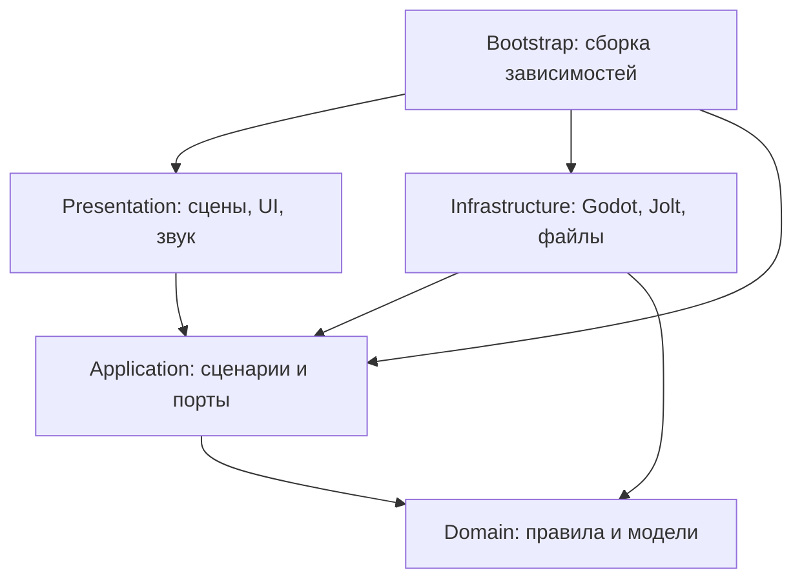

# Архитектура проекта «Эвакуация»

Статус: реализация 0.0.5-dev / SKL-04/05 от 8 ноября 2026 года. Созданы цикл сессии/ввод, контроллер перемещения, лестницы/плавание, физический перенос/бросок кубов, сеть устройств (плита, настенные кнопки, двери, логика, задержка, защёлка) и испытательный полигон. Лучи, порталы, смена гравитации и JSON-сохранения остаются целевой архитектурой. Продуктовые требования и план версий — в [Readme.md](Readme.md), порядок изменений — в [CONTRIBUTING.md](CONTRIBUTING.md).

## 1. Цели и ограничения

Архитектура должна позволять независимо проверять правила головоломок, собирать камеры из переиспользуемых устройств и менять представление без переписывания условий решения. Одновременно она должна сохранять прямой и измеримый путь к Godot/Jolt для движения, контактов и запросов пространства.

Зафиксированный стек: Godot 4.7.x Standard, строго типизированный GDScript, Forward+ с Vulkan, встроенный Jolt Physics. Собственный физический движок, нативный Vulkan-рендерер, C# и C++ для игровой логики не планируются. Материалы могут использовать язык шейдеров Godot как формат графического ресурса; правила игры остаются в GDScript. Встроенные нативные подсистемы Godot/Jolt не нарушают это ограничение.

DDD применяется к языку и правилам игры. Clean Architecture задаёт направление зависимостей. Это не серверная система: здесь не нужны микросервисы, удалённая шина, ORM, обязательный ECS или распределённые транзакции.

## 2. Зависимости и слои



Стрелка означает зависимость исходного кода. Поток выполнения может идти из Application через порт в Infrastructure; обратная зависимость к конкретному адаптеру не появляется.

| Слой | Отвечает за | Не должен делать |
| --- | --- | --- |
| Domain | Состояния устройств, условия решения, сигналы, правила зон/порталов, допустимые переходы | Искать узлы, загружать сцены, читать Input, файлы или глобальные настройки |
| Application | Сценарии взаимодействия, ход сессии, координация снимков, порты внешних операций | Зависеть от `RigidBody3D`, `Camera3D`, путей узлов и реализации Steam |
| Infrastructure | Адаптеры Jolt/Godot, пространственные запросы, управление телами, загрузка ресурсов, сохранения | Самостоятельно решать, выполнена ли головоломка или открыт ли сюжетный маршрут |
| Presentation | Сцены, камеры, анимация, интерфейс, звук, визуальная обратная связь | Хранить единственную копию прогресса или вычислять правила электрической сети |
| Bootstrap | Создание объектов, внедрение зависимостей, сборка и разборка уровня | Содержать игровые правила |

Практическая чистота GDScript: Domain и Application допускают `RefCounted` и типы значений `Vector3`, `Basis`, `Transform3D`, `StringName`, типизированные коллекции. Это осознанная зависимость от языка и математической библиотеки Godot. Независимость от исполняющей среды Godot не обещается; headless-тесты запускаются самим Godot. Запрещены `Node`, SceneTree, ResourceLoader, Input, физические/рендеринговые серверы и изменяемые авторские `Resource` внутри Domain/Application.

Порт вводится на реальной границе — физика, сохранение, контент или платформа. Отдельный интерфейс для каждой функции не требуется. Один класс может реализовывать несколько родственных операций порта; один адаптер может обслуживать множество экземпляров устройств.

## 3. Предметный язык и контексты

| Термин | Значение |
| --- | --- |
| Камера | Локальная область головоломки с входом, целью, устройствами и границей reset |
| Устройство | Именованный участник головоломки с устойчивым ID и определёнными входами/выходами |
| Сигнал | Логическое состояние соединения за определённый тик; не визуальный провод |
| Питание | Доступность энергии устройству по правилам сети |
| Эмиттер | Устройство, создающее направленный игровой световой луч при наличии питания |
| Приёмник | Устройство, преобразующее допустимое попадание луча в сигнал |
| Гравитационная зона | Область с направлением, ускорением, приоритетом и правилами включения |
| Пара порталов | Два связанных проёма с единым состоянием доступности |
| Контрольная точка | Решаемое состояние прогресса и безопасная позиция возобновления |
| Эвакуация | Терминальное состояние прохождения после достижения транспорта и выполнения финального условия |

Логические bounded contexts остаются модулями одного приложения:

| Контекст | Владеет | Связь с другими |
| --- | --- | --- |
| Puzzle | Сетью устройств, правилами сигналов, целью камеры | Получает типизированные наблюдения контактов/лучей, выдаёт эффекты |
| Traversal | Профилем перемещения, переносом предмета, политиками гравитации и порталов | Получает разрешения устройств; физическое исполнение через порты |
| Progression | Пройденными камерами, checkpoint, маршрутом и эвакуацией | Реагирует на `PuzzleSolved` и подтверждённые переходы |
| Atmosphere | Условиями постановочных событий, одноразовыми флагами | Слушает прогресс; не меняет скрыто правила Puzzle |

На первых этапах эти границы обозначаются каталогами и типами, а не отдельными пакетами и системами сообщений. Нельзя одновременно хранить «истину» об одном устройстве в нескольких контекстах.

### Агрегаты и инварианты

- `PuzzleAggregate` — сеть одной камеры и её условия решения. Только его операции меняют доменное состояние устройств. Приёмник или кнопка не изменяют соседнюю дверь напрямую.
- `PortalPair` — идентификаторы обоих проёмов, состояние питания и правила переноса. Один конец не существует в активной паре без другого.
- `ProgressState` — завершённые камеры, текущая глава, валидный checkpoint и состояние эвакуации.
- `CarryState` — не более одного удерживаемого тела на игрока; захват невозможен для запрещённой массы или неподходящего объекта.
- `GravityPolicy` — выбор одного эффективного поля по приоритету и устойчивому ID при равенстве; порядок сигналов `Area3D` не определяет результат.

Состояние физического тела принадлежит Jolt/Godot. Domain хранит только нужные правилам данные и результаты наблюдений, не вторую постоянно интегрируемую копию мира.

## 4. Структура будущего репозитория

```text
/
├── Readme.md
├── Architecture.md
├── AGENTS.md
├── CONTRIBUTING.md
├── LICENSE
├── THIRD_PARTY_NOTICES.md
├── project.godot
├── export_presets.cfg
├── src/
│   ├── domain/
│   │   ├── puzzle/
│   │   ├── traversal/
│   │   ├── progression/
│   │   └── atmosphere/
│   ├── application/
│   │   ├── ports/
│   │   ├── commands/
│   │   ├── results/
│   │   └── use_cases/
│   ├── infrastructure/
│   │   ├── godot_physics/
│   │   ├── spatial_queries/
│   │   ├── persistence/
│   │   ├── content/
│   │   └── platform/
│   ├── presentation/
│   │   ├── player/
│   │   ├── devices/
│   │   ├── portals/
│   │   ├── ui/
│   │   ├── audio/
│   │   └── effects/
│   └── bootstrap/
│       ├── main.gd
│       ├── main.tscn
│       └── level_scope.gd
├── content/
│   ├── definitions/                 # авторские Resource, преобразуются в DTO
│   ├── levels/                      # сцены и определения камер
│   ├── localization/
│   └── assets/                      # игровые ресурсы и метаданные происхождения
├── asset_sources/                   # редактируемые исходники, исключены из экспорта
├── tests/
│   ├── run_tests.gd                 # runner SceneTree
│   ├── unit/
│   ├── integration/
│   ├── regression/
│   ├── fixtures/
│   └── manual/
├── tools/                          # проверки, сборка, валидация
├── docs/
│   ├── adr/
│   ├── design/
│   └── qa/
└── builds/                         # локальные результаты, не коммитить
```

Дерево — целевое: ряд каталогов и файлов появится с соответствующей задачей. Уже существуют `LICENSE`, notices, `project.godot`, presets, базовые скрипты слоёв, тесты, инструменты, ADR и реестр рисков. `content/assets` должен содержать только разрешённые ресурсы; `.godot/`, сборки, логи и временные записи не входят в Git. Нужные Godot UID-файлы сохраняются по правилам выбранной версии, не удаляются механически как «генерация».

## 5. Типизированные контракты

Все собственные поля, параметры, результаты, сигналы и коллекции типизируются явно. Для команд, результатов и ошибок используются небольшие именованные классы, а не словари со строковыми ключами.

Примеры контрактов, которые предстоит реализовать:

| Порт / сценарий | Вход | Выход / эффект | Реализация |
| --- | --- | --- | --- |
| `PhysicsObservationPort` | `TickId`, список нужных ID | `WorldObservation` | Контакты, положение и скорости из Godot/Jolt |
| `SpatialQueryPort` | `BeamQuery`, `ExitClearanceQuery` | `BeamHit`, `ClearanceResult` | Запросы пространства Godot с масками коллизий |
| `PhysicsCommandPort` | `PhysicsCommandBatch` | `CommandReceipt` | Импульсы, поля, переносы в допустимой фазе физики |
| `SaveRepository` | `SaveSnapshot` либо `SaveSlotId` | `SaveWriteResult` / `SaveLoadResult` | Файловый адаптер с проверкой схемы |
| `LevelCatalogPort` | `LevelId` | `LevelLoadResult` | Проверка Resource/сцен, создание DTO |
| `PlatformPort` | `AchievementId` или событие релиза | Типизированный результат | Локальная no-op реализация; Steam — опционально |
| `InteractUseCase` | `InteractionCommand` | `InteractionResult` | Проверка дистанции/состояния, команда устройству |
| `AdvancePuzzleUseCase` | `WorldObservation`, `TickId` | `PuzzleStepResult` | Переход сети, список эффектов и событий |
| `RestoreCheckpointUseCase` | `CheckpointId` | `RestoreResult` | Загрузка согласованного безопасного состояния |

Порты — типизированные базовые классы GDScript, обычно на `RefCounted`. Их реализации создаёт Bootstrap; неверно подключённый обязательный порт выявляется при запуске уровня. Базовый порт не должен молча возвращать «успех» без реализации.

`Variant` и нетипизированные результаты движка неизбежны на некоторых границах: JSON, `ConfigFile`, raycast-словари. Их разрешено принимать только внутри адаптера, проверяя наличие полей, типы, диапазоны и допустимость объектов. После проверки адаптер возвращает DTO или явную ошибку. Передача сырого `Dictionary`/`Variant` в Domain/Application запрещена.

Ссылка после `as SomeType` может быть `null`; приведение не заменяет проверки. Ошибка ожидаемого типа не подавляется. События имеют типизированные данные и конкретного получателя; глобальная строковая шина событий не вводится.

## 6. Выполнение, тики и владение состоянием

### Жизненный цикл уровня

1. `Main` создаёт сервисы приложения, каталог уровней и хранилище сохранений.
2. `LevelScope` загружает и валидирует определение камеры, создаёт агрегат и адаптеры.
3. Физические узлы и представления регистрируются по стабильным ID. До окончания регистрации ввод и симуляция уровня не активируются.
4. Scope внедряет порты, связывает типизированные сигналы, применяет начальное или сохранённое состояние.
5. После подтверждения готовности открываются ввод, обновление сети и управление телами.
6. При выходе закрывается ввод, останавливается выдача команд, освобождается удерживаемый объект, снимаются подписки и очищаются отложенные эффекты.
7. Новый уровень получает новый scope; команды предыдущего поколения уровня игнорируются по `scope_id`.

Autoload разрешён для небольшого входного composition root, если необходим. Узлы устройств не ищут оттуда сервисы: скрытый service locator запрещён.

### Цикл симуляции

В текущей реализации `SessionController` применяет требования runtime/фокуса к доменным переходам `SessionLifecycle`. `SessionInput` преобразует события Godot в `GameplayInputBuffer`, который выдаёт типизированный `GameplayInputFrame`. Bootstrap передаёт его вместе с delta один раз за физический тик в `LevelScope` только при открытом игровом вводе. Scope сверяет поколение, обновляет `LookCamera`, создаёт `MovementCommand` и вызывает `PlayerMotor.step`. Сырые `InputEvent` и глобальный `Input` во внутренние слои не передаются.

Главное меню не создаёт физическую комнату. На паузе/потере фокуса физика останавливается, курсор освобождается, накопленные действия сбрасываются. Возвращение фокуса только разрешает явное продолжение. При перезапуске/возврате в меню старый scope сначала перестаёт принимать команды и удаляется из дерева, затем освобождается. Ошибка загрузки возвращает в рабочее меню без частично активной комнаты. Решение и ограничения: [ADR-0002](docs/adr/0002-session-input-lifecycle.md).

Начальная целевая частота физики — **60 Гц**, единица расстояния — **1 метр**, масса — **кг**, время — **секунда**. Это настройки проекта, не заявление о параметрах Half-Life. Переход на другую частоту требует повторного измерения управления, цепей и порталов.

Разделение фаз задаёт один координатор, а не случайный порядок `_physics_process()` разных устройств:

1. Адаптеры публикуют согласованный снимок последнего завершённого физического шага с номером тика. Контакты собираются в буфер; callbacks не меняют агрегат напрямую.
2. Координатор получает снимок и накопленные команды ввода, проверяет ID/поколение уровня и выполняет переходы логики камеры.
3. Пространственные наблюдения лучей и проёмов собираются в согласованной точке физического цикла. Обновления от прошлых поколений отбрасываются.
4. Application выдаёт пакет физических команд на следующий допустимый шаг. Адаптер каждого тела применяет его один раз в предусмотренной Godot фазе; для операций со состоянием жёсткого тела используется `_integrate_forces()` там, где это требуется API.
5. Представление получает снимок состояния и события; анимации и звук не управляют порядком логики.

Нельзя предполагать произвольный порядок между всеми `_physics_process`, контактными сигналами и `_integrate_forces`. Реализация фиксирует документированную задержку наблюдение → сигнал → действие и покрывает её интеграционным тестом. Для опасных операций тел в lock-фазе используется отложенное выполнение с подтверждением; доменное состояние не считает перенос завершённым до квитанции адаптера.

Ввод мыши/клавиатуры собирается в Presentation, физическое движение выполняется на фиксированном шаге. Визуальная интерполяция и высокая частота кадров не меняют правила цепей. Один и тот же `tick_id` не применяется повторно.

Логическая сеть должна воспроизводиться при одинаковых дискретных входах. **Побитовая идентичность физики между ОС, CPU, версиями Jolt и разными сборками не является требованием.** Тесты физических величин используют допуски.

## 7. Электрические цепи и свет

### Сеть устройств

Начальный набор: источник питания, соединение, AND, OR, NOT, задержка, защёлка, вход кнопки/приёмника, выход потребителя. Электричество моделируется дискретными логическими состояниями; аналоговая симуляция напряжения и тока не входит в первую версию.

- Комбинационный подграф вычисляется в топологическом порядке за один логический тик.
- Задержки и защёлки имеют явное состояние: читается предыдущее, записывается следующее.
- Цикл допустим только через явно заданный элемент памяти/задержки. Мгновенная комбинационная петля — ошибка определения уровня, а не повод к бесконечному пересчёту.
- Входы нормализуются, а результат фиксируется целиком: обход устройств в ином порядке не меняет его.
- Потеря питания имеет заданную семантику для каждого типа; например, обычная дверь закрывается, а защёлка сохраняет или сбрасывает память по явной конфигурации.
- Кнопка хранит множество уникальных ID тел/наблюдаемую нагрузку; повторный callback не удваивает воздействие.
- Напольная плита оценивает поддерживаемую нагрузку и допустимый контакт, а не простое наличие тела в `Area3D`. Ориентация и направление гравитации учитываются адаптером; дребезг подавляется порогом/гистерезисом.

В SKL-04/05 это реализовано агрегатом `PuzzleNetwork` (Domain), сценарием `AdvancePuzzle` и портом `PuzzleWorldPort` (Application), адаптером `PuzzleWorldAdapter` и узлами `PuzzleDeviceNode` (Infrastructure). `LevelScope` в каждом тике выполняет: движение игрока → E по настенной кнопке или перенос → шаг переноса → шаг сети. Фазы тика сети: датчики → публикация памяти → комбинационная часть в топологическом порядке с сортировкой по ID → запись памяти; при одновременных set/reset защёлки побеждает reset. Дверь не закрывается, пока проём занят. Направление стопки на плите пока мировое +Y. Решение — [ADR-0008](docs/adr/0008-device-network.md), свидетельства — [QA SKL-04/05](docs/qa/devices-circuits-2026-11-08.md).

`PuzzleSolved` возникает при переходе условия из false в true и не генерируется каждый кадр. Если решение должно быть необратимым, это отдельное правило прогресса.

### Световые головоломки

Игровой луч задаётся эмиттером, направлением, дальностью, маской преград, идентификатором канала и правилами приёмника. На 0.1.0 достаточно одного канала; цветовое смешивание и зеркала не обязательны.

Трассировка — пространственный запрос адаптера. Графический луч, свечение и динамические лампы отображают результат, но не определяют попадание. GI, exposure, тени и настройки качества не меняют решение.

Минимальная версия: один прямой луч до первой непрозрачной преграды/приёмника. Куб перекрывает луч. Пропускание луча через портал, отражения и разветвления допускаются после 0.1.0 только как явно запланированное расширение с лимитом сегментов и отдельными тестами. Это не ограничивает обязательное прохождение игрока и кубов через порталы в 0.1.0.

## 8. Движение и физическое взаимодействие

### Контроллер игрока

Базовая реализация — `CharacterBody3D` с собственным типизированным контроллером ускорения/трения и запросами Jolt через Godot. Jolt не превращает стандартный контроллер автоматически в Half-Life 1.

Профиль `MovementProfile` задаёт скорости обычного движения и медленной ходьбы, наземное/воздушное ускорение, торможение, гравитацию, высоту прыжка, высоту шага, допустимый склон, размеры стоящей/сидящей капсулы, параметры лестницы/плавания и перенос скорости опоры. Входной вектор нормализуется, чтобы диагональ не ускоряла движение непреднамеренно.

В SKL-02 `MovementSettings` (Resource в Infrastructure) преобразуется в обычный доменный профиль. `MovementRules` задаёт законы ускорения/трения; Application `ComputeMovement` возвращает желаемую скорость по типизированным наблюдениям. `PlayerMotor` (`CharacterBody3D`, Infrastructure) выполняет запросы зон/свободного места и единственный `move_and_slide()` на шаг. Второго интегратора позиции в домене нет. Камера следует за точкой глаз после движения. Коллизии создаются Jolt; лестница и вода — явные `MovementVolume` с отдельным collision layer.

В воздухе приседание поднимает нижнюю границу капсулы при сохранении положения глаз; обратное расширение проверяет весь объём. На земле сохраняется положение ступней. Подъём на ступень проверяет вертикальный и горизонтальный путь, а верх проступи ищет отдельным лучом за краем капсулы: округлённая нормаль края не подменяет нормаль пола. Плавание использует направление взгляда, Space/Ctrl и выходной импульс у поверхности; жидкость не симулируется. Параметры/ограничения зафиксированы в [ADR-0005](docs/adr/0005-player-locomotion.md).

Требуемые проверки: независимость от render FPS, движение вдоль стен, края опоры, потолок при вставании, duck-jump, уступы, ступени вверх/вниз, склоны, лестницы, плавание/погружение, выход из воды, движущаяся платформа, смена гравитации и выход из портала. Приседание не уменьшает коллизию с проникновением в потолок при обратном расширении. Вода для мувсета моделируется как область с профилем движения и границей поверхности; симуляция жидкости, плавучесть всех предметов и проведение тока через воду не входят в базовое требование.

Спринт из HL2 не добавляется автоматически. Ускорение серией прыжков, bunny hopping и другие пограничные приёмы требуют отдельного решения: мувсет HL1 не равен обязательному воспроизведению всех багов GoldSrc. Их допустимость должна быть известна дизайнерам уровней до LVL-03.

### Предметы в духе Half-Life 2

В SKL-03 реализованы `CarryState`/`CarryProfile`/`CarryRules`, сценарий `CarryController` и порт `CarryWorldPort`. `CarryPhysicsAdapter` проверяет луч/объём цели и реестр стабильных ID, `CarryRigidBody` потребляет команды с scope/tick в `_integrate_forces()`. Поддерживаются центрированные кубы BoxShape3D с единичным масштабом. На паузе удержание сохраняется, ожидающие команды отменяются; закрытие уровня снимает владение до удаления тел. Параметры, фазы и ограничения — в [ADR-0007](docs/adr/0007-physics-carry.md), свидетельства — в [QA SKL-03](docs/qa/physics-carry-2026-11-07.md).

Кубы — динамические `RigidBody3D`. Масса, трение, упругость, затухание, лимиты скоростей и параметры переноса хранятся в профилях, а не в случайных числах по скриптам.

Для поднятия используется управляемая целевая точка с ограниченными силами/моментами либо подходящее ограничение Jolt после эксперимента. Прямое присваивание transform удерживаемого куба каждый render-кадр запрещено: оно обходит контакты. Критерий выбора — устойчивость, отзывчивость и отсутствие проникновений.

- Дальность захвата и допустимая масса ограничены.
- Целевая точка приближается к игроку при препятствии, а не протаскивает предмет сквозь стену.
- Есть ограничение силы/момента, демпфирование и автоматическое отпускание при недопустимом отрыве.
- При броске прикладывается ограниченный импульс; масса влияет на скорость.
- Связка игрок/куб не создаёт бесконечный подъём, энергию или неуправляемую обратную связь.
- `CharacterBody3D` получает отдельную контролируемую политику толкания тел; неподвижная огромная масса не должна отлетать как лёгкий куб.
- Для быстрых небольших тел проверяются CCD, толщина стен и предел скорости. Маски, геометрия и корректный перенос важнее надежды на один флаг CCD.

В Jolt есть отличия и ограничения отдельных параметров joints; выбранное ограничение нужно проверить именно во встроенной версии выбранного Godot. См. [документацию Jolt в Godot 4.7](https://docs.godotengine.org/en/4.7/tutorials/physics/using_jolt_physics.html).

### Как оценивать сходство с Half-Life

Создаётся один полигон и реестр измерений: время разгона/остановки, скорость на прямой и диагонали, высота/дальность прыжка, air control, прохождение ступени, реакция кубов разных масс, время успокоения стопки, отклонение удерживаемого предмета и дальность броска.

Числа из других игр не объявляются известными без измерения. Сначала фиксируется целевой профиль ощущений и допустимые интервалы. Затем прикладываются записи с одинаковыми сценариями и результаты измерений. Если референс недоступен, результат честно называется приближением. Копирование проприетарного кода не требуется.

## 9. Гравитационные зоны

Каждая зона имеет ID, форму, направление, модуль ускорения, приоритет и состояние питания. Пересекающиеся зоны разрешаются детерминированно: приоритет → устойчивый ID. Вне зон действует базовая гравитация уровня.

Для динамических тел применяется эффективное поле адаптера; базовая гравитация не должна добавляться вторично. Изменение зоны пробуждает нужные спящие тела. Для игрока обновляются `up_direction`, опора, проекция управления и проверка потолка относительно новой вертикали.

Поворот камеры при смене поля может сглаживаться для комфорта, но физический вектор и правила выбора зоны определены однозначно. Настройка уменьшения движения камеры не меняет силы или решение. Режим нулевой гравитации и полноценный 6DOF-полёт пока вне обязательного объёма; поворот поля на стены/потолок обязателен.

При выходе из портала поле выбирается в пространстве назначения. Скорость преобразуется порталом, затем последующие ускорения задаёт поле назначения. Контроллер не выравнивает скорость по новой вертикали с потерей импульса. Переориентация капсулы должна проходить проверку свободного места.

## 10. Порталы

Порталы — отдельная подсистема Traversal с физическим адаптером и визуальным представлением. Минимум 0.1.0 — одна активная пара стационарных плоских порталов одинакового размера. Отсутствие рекурсивного изображения не означает отсутствие обычного вида сквозь портал.

### Пространственное преобразование

Пусть `A` и `B` — глобальные transforms входа и выхода. Обе системы координат ортонормированы, без отрицательного/неравномерного масштаба. `H` — поворот на 180° вокруг локальной оси вверх портала, переводящий входящую ориентацию в выходящую по принятому соглашению нормалей.

```text
M = B * H * inverse(A)
p_out = M * p_in
R = basis(M)
v_out = R * v_in
w_out = R * w_in
orientation_out = R * orientation_in
```

Перенос применяется к положению, направлению камеры, линейной и угловой скорости. Скорости не получают трансляцию. Для неподвижных порталов и ортонормированной `R` модуль скорости сохраняется в пределах численного допуска. Движущиеся порталы, масштабирование и коррекция относительно скорости проёма не входят в 0.1.0.

### Пересечение и коллизии

- Проверяется пересечение плоскости между предыдущим и текущим положением, направление прохода и попадание в допустимый проём с учётом габаритов тела. Одного `body_entered` недостаточно для быстрых объектов.
- Отверстие имеет настоящую проходимую коллизию. Отключать коллизию всей стены ради портала нельзя.
- До переноса проверяется свободное место на выходе для всего тела. Политика занятого выхода: перенос не подтверждается, объект удерживается на допустимой стороне входного проёма без проникновения; визуальная обратная связь показывает блокировку.
- Простого отказа от teleport недостаточно: в заблокированном состоянии адаптер обеспечивает физическую преграду/коррекцию безопасного положения в проёме. Этот сценарий проверяется отдельно на высокой скорости.
- Один crossing получает уникальный ID. Повторное применение блокируется до выхода из защитной области назначения; один таймер не является единственной защитой.
- Перенос и восстановление скорости выполняются согласованно с физическим шагом, без продолжающего действовать старого carry-joint или stale-команды.
- Начальная политика удерживаемого куба: связка проходит как один проверяемый перенос, если оба тела помещаются; иначе захват безопасно отпускается до переноса. Игрок и предмет не должны связываться через стену двух пространств.
- В тестах обязательны пол/стена/потолок, разные ориентации, высокая скорость, возврат, пересечение краем, смена питания при проходе, занятый выход и reset.
- Отключение питания не закрывает проём внутри тела. Пара завершает уже подтверждённый проход либо безопасно возвращает незавершённый на входную сторону по задокументированной политике.

### Изображение

Предлагаемая реализация: `SubViewport` и дополнительная `Camera3D`, камера преобразуется тем же `M`. Материал проёма показывает render target. Нужно решить отсечение геометрии у плоскости выхода, согласование FOV/aspect, occlusion и размещение поверхности без мерцания.

Конкретный способ clipping/проекции проверяется в SKL-08 на Godot 4.7: это исследовательская задача, не заявленная встроенная функция. В первой версии рекурсивная отрисовка выключена: порталы внутри портального вида получают стабильное упрощённое представление. Основной вид через портал сохраняется. Позднее глубина 1–2 допускается только после профилирования и явного лимита стоимости.

Если полноценный вид и пересечение не проходят критерии, 0.1.0 остаётся незавершённой. Подмена портала загрузочным экраном или телепортом без обзора требует отдельного пересмотра требований владельцем.

## 11. Уровни, контент и валидация

Авторский `LevelDefinition` — `Resource` в Infrastructure/Content. Он содержит ID уровня и камер, версию данных, таблицу устройств, соединения, начальные состояния, spawn, checkpoint, reset, условия выхода и ссылку на сцену. При загрузке валидатор создаёт доменные DTO. Domain не читает `.tres` и не ищет узлы.

Устройства в сценах имеют стабильные ID, совпадающие с определением уровня. NodePath, instance ID и позиция в массиве не используются как постоянная идентичность сохранений.

Валидатор выявляет:

- дубли и отсутствующие ID, несовместимые типы портов и незарегистрированные адаптеры;
- мгновенные циклы сети и недопустимые параметры задержек/порогов;
- неполные пары порталов, неверный масштаб и слишком маленькие проёмы;
- отсутствующие точки входа, выхода, checkpoint и восстановления кубов;
- пересечение spawn с коллизиями, выход за допустимые границы и неверные маски;
- неизвестные версии данных и неподдерживаемые типы устройств.

Валидатор не доказывает решаемость физической головоломки. Каждая камера требует фактического прохождения и проверки потери предметов. Арт-проход не меняет игровые коллизии без повторного тестирования.

## 12. Сохранения и восстановление

**Обязательный формат сохранения прогресса — JSON в UTF-8**, файлы `*.json` в `user://saves/`. Это решение для будущей реализации SKL-10/SYS-04; сериализатор и файлы сохранений пока не созданы. Точный состав схемы определяется при реализации и фиксируется fixtures до первого выпуска формата. См. [ADR-0003](docs/adr/0003-json-save-format.md).

Сохраняются `schema_version`, версия игры, `level_id`, `checkpoint_id`, завершённые камеры, дискретные состояния устройств, память цепей и одноразовые события. Настройки управления/графики/звука хранятся отдельно от прогресса.

JSON-кодек и файловый адаптер принадлежат Infrastructure и реализуют `SaveRepository`. Domain/Application получают `SaveSnapshot` или типизированный результат ошибки. На чтении сначала проверяются синтаксис, корневой объект, версия схемы, обязательные поля, типы, диапазоны и ссылки на известный контент; только затем строятся DTO. ID кодируются строками, векторы/ориентации — явно описанными JSON-полями, а не строками Godot или объектами движка. Невалидные/нечисловые физические значения отвергаются. Данные старых схем проходят явные миграции; неизвестная новая схема не загружается приблизительно.

**Политика 0.1.0:** сохранение на безопасных контрольных точках. После загрузки активная камера получает согласованное начальное/checkpoint-состояние; физические предметы восстанавливаются в утверждённых позах, перенос отпущен, незавершённые пересечения портала отменены. Произвольный quicksave посреди полёта предмета не обещается. Это ограничение должно быть видно игроку.

Если позднее потребуется сохранять промежуточную конфигурацию камеры, схема явно включает все связанные состояния и безопасное восстановление тел. Сериализация SceneTree, ссылок Node, Jolt handles и сырых runtime-объектов запрещена.

Порядок записи: создать валидный DTO → преобразовать в JSON → записать временный файл в каталоге сохранений → закрыть и проверить → заменить основной `*.json` с сохранением предыдущего исправного. Конкретная атомарность замены проверяется на каждой целевой ОС. Повреждённый файл не затирается автоматически; предлагается резервная копия или новая игра с понятным сообщением.

Неизвестная новая версия схемы приводит к безопасному отказу, а не попытке угадать поля. Для старых версий — явная миграция с тестовыми fixtures либо документированная несовместимость дорелизной версии. Reset камеры очищает очередь команд, carry-state, контакты, таймеры, лучи и portal crossing guards, затем восстанавливает единый снимок.

## 13. Рендеринг, звук и производительность

### Диегетическое представление

Финальный игровой интерфейс имеет носитель внутри мира и доступен протагонисту. По [ADR-0006](docs/adr/0006-art-direction.md) основной носитель — наручный полевой терминал Клетуса; дополнительные — нагрудный индикатор, человеческие терминалы сооружения, маркировка и состояния устройств. Сама по себе отрисовка текста в 3D не выполняет требование. Это относится к целям, взаимодействиям, состояниям устройств, подсказкам, сохранениям и представлению меню/паузы. Выбор носителей принят, их работа и читаемость проверяются через срез 0.3.0 и библию мира 0.4.0. См. [ADR-0004](docs/adr/0004-diegetic-interface.md) и [руководство по применению концепта](docs/design/art-production-guide.md).

Диегетическое представление остаётся в Presentation и вызывает типизированные сценарии Application. Терминал/дисплей не владеет прогрессом, не решает головоломку и не читает JSON сам. Визуальный носитель checkpoint не меняет правила безопасного сохранения. Меню продолжает работать при остановленной симуляции; оформление сохраняет существующую политику фокуса/курсора и явного продолжения.

На приёмке проверяются читаемость при поддерживаемых FOV/разрешениях, контраст, управление клавиатурой и мышью, отсутствие зависимости только от цвета и возможность прочесть важную информацию без точного удержания камеры. Диегетичность не оправдывает скрытые команды или потерю доступности. Текущие `FoundationHud`/CanvasLayer и технический прицел — временная оболочка; они не доказывают готовность финального интерфейса. Замена планируется в SLICE-02/ART-02/EXP-03.

### Графический backend и бюджеты

Forward+ выбирается для desktop 3D, а драйвер **Vulkan фиксируется явно** на Windows и Linux. Forward+ сам по себе не гарантирует Vulkan: Godot поддерживает другие драйверы и fallback. На Vulkan-only профиле отключаются автоматические переходы на D3D12/OpenGL; фактический backend проверяется при старте и в GPU-smoke. Если Vulkan не инициализируется, поддерживаемый путь запуска не считается пройденным. См. [обзор рендереров](https://docs.godotengine.org/en/4.7/tutorials/rendering/renderers.html) и [ProjectSettings](https://docs.godotengine.org/en/4.7/classes/class_projectsettings.html).

Настройки реализации для выбранной сборки проверяются в FND-03: `rendering/renderer/rendering_method`, `rendering/rendering_device/driver.windows`, `driver.linuxbsd`, `fallback_to_d3d12` и `fallback_to_opengl3`. Названия и смысл сверяются с документацией версии; значения не меняются автоматически ради зелёного теста. Headless-проверки используют свои условия и не предъявляются как GPU-проверка.

Предварительные бюджеты, которые уточняются в SYS-06 и SLICE-04:

| Показатель | Начальная цель | Условия измерения |
| --- | --- | --- |
| Кадр | 60 FPS, p95 времени кадра ≤ 16,7 мс | 1920×1080, выбранный опорный ПК, после прогрева, без VSync-ограничения замера |
| Физический шаг | p95 ≤ 4 мс при 60 Гц | Камера с нагрузкой, отражающей верхнюю границу обычной игры |
| Порталы | Одна активная пара, без рекурсии | Измерять кадр с обоими проёмами в поле зрения |
| Оперативная память | Предварительно ≤ 4 ГиБ процесса | Самый тяжёлый сектор и несколько переходов |
| Восстановление checkpoint | Предварительно ≤ 5 с с SSD | Экспортированный билд, отдельно холодная/тёплая загрузка |

До выбора опорного оборудования это инженерные ориентиры, а не опубликованные минимальные системные требования. В отчёт входят CPU/GPU/RAM, ОС, драйвер, версия Godot, разрешение, настройки, сцена и длительность измерения; загрузочные паузы измеряются отдельно. По одному среднему FPS нельзя принимать релиз.

Звук получает события и снимки состояния через Presentation. Выключение звука или эффектов не меняет правила. Важная информация дублируется доступным визуальным/текстовым каналом. Система атмосферы не уничтожает обязательный предмет без восстановления и не блокирует ввод во время точного действия без явного дизайна.

## 14. Проверки и наблюдаемость

| Уровень | Что проверяет | Где запускается |
| --- | --- | --- |
| Статический | Типы, предупреждения, зависимости слоёв, ссылки ресурсов | CI и локально |
| Unit | Сеть, приоритеты полей, условия решения, прогресс, математика порталов | Headless Godot, без сцен уровня |
| Контрактный | Валидация DTO, ошибки портов, формат сохранения, миграции | Headless с fixtures и fake-адаптерами |
| Интеграционный | Jolt, движение, перенос, контакты, reset, загрузка | Физические тестовые сцены на фиксированных тиках |
| GPU smoke | Фактический Vulkan, портальный вид, clipping, эффекты | Компьютер с реальным Vulkan GPU |
| Прохождение | Решаемость, обучение, атмосфера, отсутствие блокировок | Экспортированный билд, новые игроки |

Математические тесты портала: преобразование туда/обратно, сохранение нормы скорости, преобразование угловой скорости, разные ориентации, неприемлемый масштаб. Интеграция проверяет реальные коллизии отдельно от этих формул.

Диагностика debug-сборки показывает ID устройства, текущие входы/выходы, поле гравитации, лучи, collision masks, tick/scope/crossing ID и стоимость подсистем. Release не содержит отладочных обходов головоломок. Ошибки логируются с ID уровня/устройства и версией сборки, без персональных данных и секретов.

## 15. Распространение и границы Steam

Игровой запуск и прогресс не зависят от Steam. Первое воплощение `PlatformPort` — локальный no-op адаптер. Публикация в Steam сама по себе не требует вводить достижения, Cloud или Workshop в обязательный объём.

Если позже нужен Steamworks SDK/плагин, его лицензия, способ поставки и совместимость проверяются отдельно. Сторонний SDK не объявляется MIT из-за лицензии проекта. Он не проникает в Domain/Application; отсутствие платформенного клиента не ломает самостоятельную сборку.

## 16. Решения и порядок изменения

Начальные архитектурные решения закреплены в этом документе:

| Решение | Содержание | Когда пересматривать |
| --- | --- | --- |
| A-01 | Godot 4.7.x Standard, GDScript, Vulkan, встроенный Jolt | Подтверждённый дефект/несовместимость, отдельное решение владельца по смене стека |
| A-02 | Domain/Application без SceneTree и физических узлов | Только через ADR с оценкой тестируемости |
| A-03 | Jolt — источник физического состояния, домен — источник правил | Не дублировать состояние при расширении механик |
| A-04 | Фиксированные пары порталов и ограниченная визуальная сложность | После прохождения SKL-09 и профилирования |
| A-05 | Дискретные цепи, игровые лучи отдельно от освещения | При обоснованной новой головоломке |
| A-06 | Checkpoint-сохранения в JSON UTF-8, отдельная версия схемы | При изменении политики сохранения; смена формата требует решения владельца |
| A-07 | Steam как внешний канал и опциональный адаптер | При добавлении конкретной платформенной функции |
| A-08 | Диегетический финальный интерфейс, носители и представление отделены от правил | Носители уточняются в срезе; отказ от требования — только по решению владельца |

Файлы ADR создаются по мере реализации в `docs/adr/NNNN-topic.md`: контекст → варианты → решение → последствия → проверка. Начальное решение о среде зафиксировано в [ADR-0001](docs/adr/0001-foundation-toolchain.md); есть [шаблон](docs/adr/template.md). Остальные строки таблицы не означают наличие отдельных ADR-файлов. Изменение требований владельца имеет приоритет; после решения обновляются архитектура, roadmap, тесты и инструкции участников.
