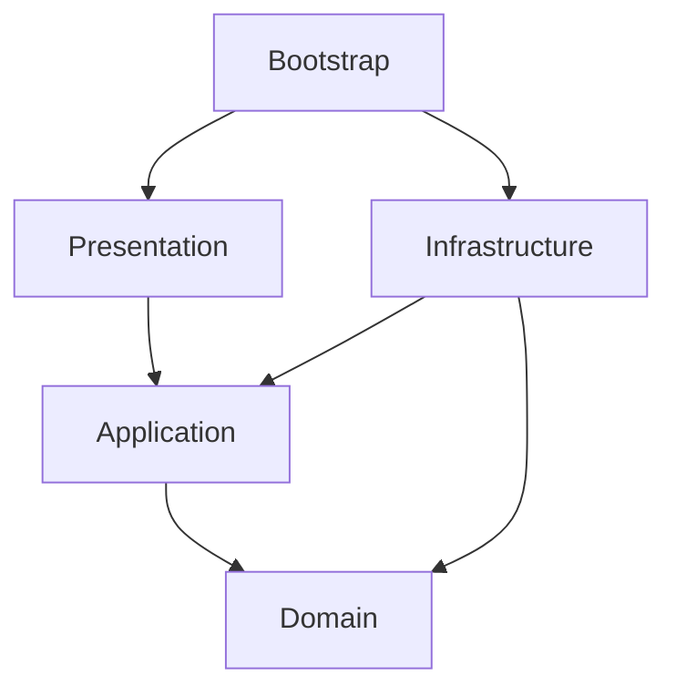

# Архитектура Abandoned

Godot/Jolt исполняет физику, домен определяет игровые правила. Presentation передаёт действия в Application и показывает результат; Bootstrap связывает реализации. Состояние готовности — в [status](docs/status.md), обязательный объём — в [требованиях](docs/requirements.md).

Стрелки означают зависимости кода. Вызов через порт не создаёт обратной зависимости Application от конкретного адаптера. Правила, допустимые типы и владение состоянием — в [основе архитектуры](docs/architecture/foundation.md#2-зависимости-и-слои).

## Найти нужный контракт

| Изменение | Справочник | Принятое решение |
| --- | --- | --- |
| Слои, DTO, загрузка scope, тики и ввод | [Основа](docs/architecture/foundation.md) | [Жизненный цикл](docs/adr/0002-session-input-lifecycle.md) |
| Устройства, цепи, лучи | [Цепи](docs/architecture/circuits.md) | [ADR-0008](docs/adr/0008-device-network.md) |
| Движение, перенос, бросок, постановка | [Движение](docs/architecture/movement.md) | [Мувсет](docs/adr/0005-player-locomotion.md), [актуальный захват](docs/adr/0012-talos-carry.md) |
| Выбор поля и ориентация игрока | [Гравитация](docs/architecture/gravity.md) | [ADR-0009](docs/adr/0009-gravity-zones.md) |
| Вид, пересечение и занятый выход | [Порталы](docs/architecture/portals.md) | [Эксперимент SKL-08](docs/adr/0010-portal-experiment.md) |
| Контент, checkpoint, JSON и reset | [Контент и сохранения](docs/architecture/content-and-saves.md) | [Формат JSON](docs/adr/0003-json-save-format.md) |
| Диегетический UI, графика и звук | [Представление](docs/architecture/presentation.md) | [UI](docs/adr/0004-diegetic-interface.md), [арт](docs/adr/0006-art-direction.md) |
| Свидетельства и диагностика | [Проверки](docs/architecture/validation.md) | [Команды](docs/development/checks.md) |
| Платформа и пересмотр решений | [Распространение](docs/architecture/distribution.md) | [Индекс ADR](docs/adr/README.md) |

## Жизненный цикл

Main создаёт сервисы, LevelScope — зависимости конкретного уровня. Снимок ввода применяется один раз на физический тик и только для текущего поколения. Закрытие scope прекращает команды и освобождает зависимости. Подробный [порядок фаз и владение состоянием](docs/architecture/foundation.md#6-выполнение-тики-и-владение-состоянием) — основной источник этих контрактов.

## Как менять архитектуру

Изменение направления зависимостей, порядка тиков, схемы сохранения, портальной математики или физического backend требует ADR с последствиями и проверками. Смена стека и обязательных механик требует решения владельца. Технические страницы различают целевое поведение, реализованные части и исторические варианты; они не поручают реализовать все упомянутые системы.

Ссылки из прежней структуры

- [1. Цели и ограничения](docs/architecture/foundation.md#1-цели-и-ограничения)

- [2. Зависимости и слои](docs/architecture/foundation.md#2-зависимости-и-слои)

- [3. Предметный язык и контексты](docs/architecture/foundation.md#3-предметный-язык-и-контексты)

- [Агрегаты и инварианты](docs/architecture/foundation.md#агрегаты-и-инварианты)

- [4. Структура будущего репозитория](docs/architecture/foundation.md#4-структура-будущего-репозитория)

- [5. Типизированные контракты](docs/architecture/foundation.md#5-типизированные-контракты)

- [6. Выполнение, тики и владение состоянием](docs/architecture/foundation.md#6-выполнение-тики-и-владение-состоянием)

- [Жизненный цикл уровня](docs/architecture/foundation.md#жизненный-цикл-уровня)

- [Цикл симуляции](docs/architecture/foundation.md#цикл-симуляции)

- [7. Электрические цепи и свет](docs/architecture/circuits.md#7-электрические-цепи-и-свет)

- [Сеть устройств](docs/architecture/circuits.md#сеть-устройств)

- [Световые головоломки](docs/architecture/circuits.md#световые-головоломки)

- [8. Движение и физическое взаимодействие](docs/architecture/movement.md#8-движение-и-физическое-взаимодействие)

- [Контроллер игрока](docs/architecture/movement.md#контроллер-игрока)

- [Предметы в духе Half-Life 2](docs/architecture/movement.md#предметы-в-духе-half-life-2)

- [Как оценивать сходство с Half-Life](docs/architecture/movement.md#как-оценивать-сходство-с-half-life)

- [9. Гравитационные зоны](docs/architecture/gravity.md#9-гравитационные-зоны)

- [10. Порталы](docs/architecture/portals.md#10-порталы)

- [Пространственное преобразование](docs/architecture/portals.md#пространственное-преобразование)

- [Пересечение и коллизии](docs/architecture/portals.md#пересечение-и-коллизии)

- [Изображение](docs/architecture/portals.md#изображение)

- [11. Уровни, контент и валидация](docs/architecture/content-and-saves.md#11-уровни-контент-и-валидация)

- [12. Сохранения и восстановление](docs/architecture/content-and-saves.md#12-сохранения-и-восстановление)

- [13. Рендеринг, звук и производительность](docs/architecture/presentation.md#13-рендеринг-звук-и-производительность)

- [Диегетическое представление](docs/architecture/presentation.md#диегетическое-представление)

- [Графический backend и бюджеты](docs/architecture/presentation.md#графический-backend-и-бюджеты)

- [14. Проверки и наблюдаемость](docs/architecture/validation.md#14-проверки-и-наблюдаемость)

- [15. Распространение и границы Steam](docs/architecture/distribution.md#15-распространение-и-границы-steam)

- [16. Решения и порядок изменения](docs/architecture/distribution.md#16-решения-и-порядок-изменения)

Ссылки из прежней структуры

- [Архитектура проекта «Эвакуация»](Architecture.md#архитектура-abandoned)

