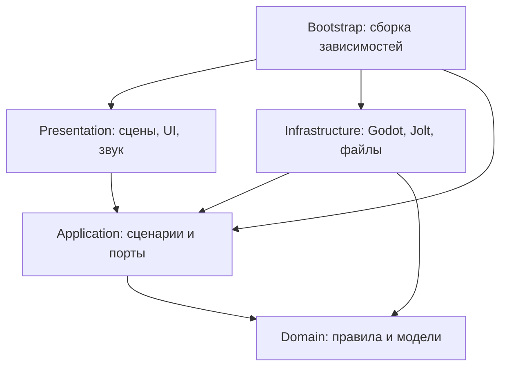

# Слои, контракты и жизненный цикл

[Карта архитектуры](../../Architecture.md) · [решения ADR](../adr/README.md) · [текущее состояние](../status.md).

Это технический справочник: целевые контракты не означают готовую реализацию. Реализованные части отмечены в тексте и подтверждаются ссылками на ADR/QA.

- [1. Цели и ограничения](#1-цели-и-ограничения)
- [2. Зависимости и слои](#2-зависимости-и-слои)
- [3. Предметный язык и контексты](#3-предметный-язык-и-контексты)
- [4. Структура будущего репозитория](#4-структура-будущего-репозитория)
- [5. Типизированные контракты](#5-типизированные-контракты)
- [6. Выполнение, тики и владение состоянием](#6-выполнение-тики-и-владение-состоянием)

## 1. Цели и ограничения

Архитектура должна позволять независимо проверять правила головоломок, собирать камеры из переиспользуемых устройств и менять представление без переписывания условий решения. Одновременно она должна сохранять прямой и измеримый путь к Godot/Jolt для движения, контактов и запросов пространства.

Зафиксированный стек: Godot 4.7.x Standard, строго типизированный GDScript, Forward+ с Vulkan, встроенный Jolt Physics. Собственный физический движок, нативный Vulkan-рендерер, C# и C++ для игровой логики не планируются. Материалы могут использовать язык шейдеров Godot как формат графического ресурса; правила игры остаются в GDScript. Встроенные нативные подсистемы Godot/Jolt не нарушают это ограничение.

DDD применяется к языку и правилам игры. Clean Architecture задаёт направление зависимостей. Это не серверная система: здесь не нужны микросервисы, удалённая шина, ORM, обязательный ECS или распределённые транзакции.


## 2. Зависимости и слои



Стрелка означает зависимость исходного кода. Поток выполнения может идти из Application через порт в Infrastructure; обратная зависимость к конкретному адаптеру не появляется.

| Слой | Отвечает за | Не должен делать |
| --- | --- | --- |
| Domain | Состояния устройств, условия решения, сигналы, правила зон/порталов, допустимые переходы | Искать узлы, загружать сцены, читать Input, файлы или глобальные настройки |
| Application | Сценарии взаимодействия, ход сессии, координация снимков, порты внешних операций | Зависеть от `RigidBody3D`, `Camera3D`, путей узлов и реализации Steam |
| Infrastructure | Адаптеры Jolt/Godot, пространственные запросы, управление телами, загрузка ресурсов, сохранения | Самостоятельно решать, выполнена ли головоломка или открыт ли сюжетный маршрут |
| Presentation | Сцены, камеры, анимация, интерфейс, звук, визуальная обратная связь | Хранить единственную копию прогресса или вычислять правила электрической сети |
| Bootstrap | Создание объектов, внедрение зависимостей, сборка и разборка уровня | Содержать игровые правила |

Практическая чистота GDScript: Domain и Application допускают `RefCounted` и типы значений `Vector3`, `Basis`, `Transform3D`, `StringName`, типизированные коллекции. Это осознанная зависимость от языка и математической библиотеки Godot. Независимость от исполняющей среды Godot не обещается; headless-тесты запускаются самим Godot. Запрещены `Node`, SceneTree, ResourceLoader, Input, физические/рендеринговые серверы и изменяемые авторские `Resource` внутри Domain/Application.

Порт вводится на реальной границе — физика, сохранение, контент или платформа. Отдельный интерфейс для каждой функции не требуется. Один класс может реализовывать несколько родственных операций порта; один адаптер может обслуживать множество экземпляров устройств.


## 3. Предметный язык и контексты

| Термин | Значение |
| --- | --- |
| Камера | Локальная область головоломки с входом, целью, устройствами и границей reset |
| Устройство | Именованный участник головоломки с устойчивым ID и определёнными входами/выходами |
| Сигнал | Логическое состояние соединения за определённый тик; не визуальный провод |
| Питание | Доступность энергии устройству по правилам сети |
| Эмиттер | Устройство, создающее направленный игровой световой луч при наличии питания |
| Приёмник | Устройство, преобразующее допустимое попадание луча в сигнал |
| Гравитационная зона | Область с направлением, ускорением, приоритетом и правилами включения |
| Пара порталов | Два связанных проёма с единым состоянием доступности |
| Контрольная точка | Решаемое состояние прогресса и безопасная позиция возобновления |
| Эвакуация | Терминальное состояние прохождения после достижения транспорта и выполнения финального условия |

Логические bounded contexts остаются модулями одного приложения:

| Контекст | Владеет | Связь с другими |
| --- | --- | --- |
| Puzzle | Сетью устройств, правилами сигналов, целью камеры | Получает типизированные наблюдения контактов/лучей, выдаёт эффекты |
| Traversal | Профилем перемещения, переносом предмета, политиками гравитации и порталов | Получает разрешения устройств; физическое исполнение через порты |
| Progression | Пройденными камерами, checkpoint, маршрутом и эвакуацией | Реагирует на `PuzzleSolved` и подтверждённые переходы |
| Atmosphere | Условиями постановочных событий, одноразовыми флагами | Слушает прогресс; не меняет скрыто правила Puzzle |

На первых этапах эти границы обозначаются каталогами и типами, а не отдельными пакетами и системами сообщений. Нельзя одновременно хранить «истину» об одном устройстве в нескольких контекстах.

### Агрегаты и инварианты

- `PuzzleAggregate` — сеть одной камеры и её условия решения. Только его операции меняют доменное состояние устройств. Приёмник или кнопка не изменяют соседнюю дверь напрямую.
- `PortalPair` — идентификаторы обоих проёмов, состояние питания и правила переноса. Один конец не существует в активной паре без другого.
- `ProgressState` — завершённые камеры, текущая глава, валидный checkpoint и состояние эвакуации.
- `CarryState` — не более одного удерживаемого тела на игрока; захват невозможен для запрещённой массы или неподходящего объекта.
- `GravityPolicy` — выбор одного эффективного поля по приоритету и устойчивому ID при равенстве; порядок сигналов `Area3D` не определяет результат.

Состояние физического тела принадлежит Jolt/Godot. Domain хранит только нужные правилам данные и результаты наблюдений, не вторую постоянно интегрируемую копию мира.


## 4. Структура будущего репозитория

```text
/
├── Readme.md
├── Architecture.md
├── AGENTS.md
├── CONTRIBUTING.md
├── LICENSE
├── THIRD_PARTY_NOTICES.md
├── project.godot
├── export_presets.cfg
├── src/
│   ├── domain/
│   │   ├── puzzle/
│   │   ├── traversal/
│   │   ├── progression/
│   │   └── atmosphere/
│   ├── application/
│   │   ├── ports/
│   │   ├── commands/
│   │   ├── results/
│   │   └── use_cases/
│   ├── infrastructure/
│   │   ├── godot_physics/
│   │   ├── spatial_queries/
│   │   ├── persistence/
│   │   ├── content/
│   │   └── platform/
│   ├── presentation/
│   │   ├── player/
│   │   ├── devices/
│   │   ├── portals/
│   │   ├── ui/
│   │   ├── audio/
│   │   └── effects/
│   └── bootstrap/
│       ├── main.gd
│       ├── main.tscn
│       └── level_scope.gd
├── content/
│   ├── definitions/                 # авторские Resource, преобразуются в DTO
│   ├── levels/                      # сцены и определения камер
│   ├── localization/
│   └── assets/                      # игровые ресурсы и метаданные происхождения
├── asset_sources/                   # редактируемые исходники, исключены из экспорта
├── tests/
│   ├── run_tests.gd                 # runner SceneTree
│   ├── unit/
│   ├── integration/
│   ├── regression/
│   ├── fixtures/
│   └── manual/
├── tools/                          # проверки, сборка, валидация
├── docs/
│   ├── adr/
│   ├── design/
│   └── qa/
└── builds/                         # локальные результаты, не коммитить
```

Дерево — целевое: ряд каталогов и файлов появится с соответствующей задачей. Уже существуют `LICENSE`, notices, `project.godot`, presets, базовые скрипты слоёв, тесты, инструменты, ADR и реестр рисков. `content/assets` должен содержать только разрешённые ресурсы; `.godot/`, сборки, логи и временные записи не входят в Git. Нужные Godot UID-файлы сохраняются по правилам выбранной версии, не удаляются механически как «генерация».


## 5. Типизированные контракты

Все собственные поля, параметры, результаты, сигналы и коллекции типизируются явно. Для команд, результатов и ошибок используются небольшие именованные классы, а не словари со строковыми ключами.

**Реализованные границы:** `CarryWorldPort` → `CarryPhysicsAdapter`, `PuzzleWorldPort` → `PuzzleWorldAdapter`, `GravityWorldPort` → `GravityWorldAdapter`, `PortalWorldPort` → `PortalWorldAdapter`. Сценарии `CarryController`, `AdvancePuzzle`, `SampleGravity`, `AdvancePortals` работают с DTO; `LevelScope` связывает их с Godot. Каталог пока конкретный `LevelCatalog`, без отдельного `LevelCatalogPort`.

Следующая таблица — примеры **целевых** контрактов, не перечень существующих классов. В частности, SaveRepository, PlatformPort и RestoreCheckpointUseCase ещё отсутствуют:

| Порт / сценарий | Вход | Выход / эффект | Реализация |
| --- | --- | --- | --- |
| `PhysicsObservationPort` | `TickId`, список нужных ID | `WorldObservation` | Контакты, положение и скорости из Godot/Jolt |
| `SpatialQueryPort` | `BeamQuery`, `ExitClearanceQuery` | `BeamHit`, `ClearanceResult` | Запросы пространства Godot с масками коллизий |
| `PhysicsCommandPort` | `PhysicsCommandBatch` | `CommandReceipt` | Импульсы, поля, переносы в допустимой фазе физики |
| `SaveRepository` | `SaveSnapshot` либо `SaveSlotId` | `SaveWriteResult` / `SaveLoadResult` | Файловый адаптер с проверкой схемы |
| `LevelCatalogPort` | `LevelId` | `LevelLoadResult` | Проверка Resource/сцен, создание DTO |
| `PlatformPort` | `AchievementId` или событие релиза | Типизированный результат | Локальная no-op реализация; Steam — опционально |
| `InteractUseCase` | `InteractionCommand` | `InteractionResult` | Проверка дистанции/состояния, команда устройству |
| `AdvancePuzzleUseCase` | `WorldObservation`, `TickId` | `PuzzleStepResult` | Переход сети, список эффектов и событий |
| `RestoreCheckpointUseCase` | `CheckpointId` | `RestoreResult` | Загрузка согласованного безопасного состояния |

Порты — типизированные базовые классы GDScript, обычно на `RefCounted`. Их реализации создаёт Bootstrap; неверно подключённый обязательный порт выявляется при запуске уровня. Базовый порт не должен молча возвращать «успех» без реализации.

`Variant` и нетипизированные результаты движка неизбежны на некоторых границах: JSON, `ConfigFile`, raycast-словари. Их разрешено принимать только внутри адаптера, проверяя наличие полей, типы, диапазоны и допустимость объектов. После проверки адаптер возвращает DTO или явную ошибку. Передача сырого `Dictionary`/`Variant` в Domain/Application запрещена.

Ссылка после `as SomeType` может быть `null`; приведение не заменяет проверки. Ошибка ожидаемого типа не подавляется. События имеют типизированные данные и конкретного получателя; глобальная строковая шина событий не вводится.


## 6. Выполнение, тики и владение состоянием

### Жизненный цикл уровня

1. `SessionBootstrap` (`main.gd`) создаёт сервисы сессии и использует `LevelCatalog`; хранилища сохранений пока нет.
2. `LevelScope` создаёт `PackedScene`, проверяет Player/Camera, строит сеть устройств, адаптеры переноса, гравитации и порталов.
3. Физические узлы и представления регистрируются по стабильным ID. До окончания регистрации ввод и симуляция уровня не активируются.
4. Scope внедряет порты и применяет начальное состояние. Сохранённого/checkpoint-состояния пока нет — [граница текущей реализации](content-and-saves.md).
5. После подтверждения готовности открываются ввод, обновление сети и управление телами.
6. При выходе закрывается ввод, останавливается выдача команд, освобождается удерживаемый объект, снимаются подписки и очищаются отложенные эффекты.
7. Новый уровень получает новый scope; команды предыдущего поколения уровня игнорируются по `scope_id`.

Autoload разрешён для небольшого входного composition root, если необходим. Узлы устройств не ищут оттуда сервисы: скрытый service locator запрещён.

### Цикл симуляции

В текущей реализации `SessionController` применяет требования runtime/фокуса к доменным переходам `SessionLifecycle`. `SessionInput` преобразует события Godot в `GameplayInputBuffer`, который выдаёт типизированный `GameplayInputFrame`. Bootstrap передаёт его вместе с delta один раз за физический тик в `LevelScope` только при открытом игровом вводе. Scope сверяет поколение, обновляет `LookCamera`, создаёт `MovementCommand` и вызывает `PlayerMotor.step`. Сырые `InputEvent` и глобальный `Input` во внутренние слои не передаются.

Главное меню не создаёт физическую комнату. На паузе/потере фокуса физика останавливается, курсор освобождается, накопленные действия сбрасываются. Возвращение фокуса только разрешает явное продолжение. При перезапуске/возврате в меню старый scope сначала перестаёт принимать команды и удаляется из дерева, затем освобождается. Ошибка загрузки возвращает в рабочее меню без частично активной комнаты. Решение и ограничения: [ADR-0002](../adr/0002-session-input-lifecycle.md).

Начальная целевая частота физики — **60 Гц**, единица расстояния — **1 метр**, масса — **кг**, время — **секунда**. Это настройки проекта, не заявление о параметрах Half-Life. Переход на другую частоту требует повторного измерения управления, цепей и порталов.

Разделение фаз задаёт один координатор, а не случайный порядок `_physics_process()` разных устройств:

1. Адаптеры публикуют согласованный снимок последнего завершённого физического шага с номером тика. Контакты собираются в буфер; callbacks не меняют агрегат напрямую.
2. Координатор получает снимок и накопленные команды ввода, проверяет ID/поколение уровня и выполняет переходы логики камеры.
3. Пространственные наблюдения лучей и проёмов собираются в согласованной точке физического цикла. Обновления от прошлых поколений отбрасываются.
4. Application выдаёт пакет физических команд на следующий допустимый шаг. Адаптер каждого тела применяет его один раз в предусмотренной Godot фазе; для операций со состоянием жёсткого тела используется `_integrate_forces()` там, где это требуется API.
5. Представление получает снимок состояния и события; анимации и звук не управляют порядком логики.

Нельзя предполагать произвольный порядок между всеми `_physics_process`, контактными сигналами и `_integrate_forces`. Реализация фиксирует документированную задержку наблюдение → сигнал → действие и покрывает её интеграционным тестом. Для опасных операций тел в lock-фазе используется отложенное выполнение с подтверждением; доменное состояние не считает перенос завершённым до квитанции адаптера.

Ввод мыши/клавиатуры собирается в Presentation, физическое движение выполняется на фиксированном шаге. Визуальная интерполяция и высокая частота кадров не меняют правила цепей. Один и тот же `tick_id` не применяется повторно.

Логическая сеть должна воспроизводиться при одинаковых дискретных входах. **Побитовая идентичность физики между ОС, CPU, версиями Jolt и разными сборками не является требованием.** Тесты физических величин используют допуски.

## Инварианты изменения

- `src/domain`: правила, модели, значения, события. Никаких `Node`, SceneTree, Input, файлов, ResourceLoader, PhysicsServer/RenderingServer и изменяемых авторских Resource.
- `src/application`: сценарии, DTO и порты. Не зависит от сцен, физических тел, UI и Steam SDK.
- `src/infrastructure`: Godot/Jolt, пространственные запросы, сохранения, загрузка контента и внешние платформы; реализует порты внутренних слоёв.
- `src/presentation`: сцены, ввод, камеры, UI, звук, эффекты; направляет действия в Application и отображает результат.
- `src/bootstrap`: создание, внедрение, регистрация и освобождение зависимостей.
- `RefCounted`, математические типы Godot и типизированные коллекции допустимы во внутренних слоях. Headless Godot остаётся средой их выполнения.
- Порт нужен на внешней границе, а не у каждого метода. Не создавать микросервисы, универсальную шину, service locator, обязательный ECS или преждевременную систему плагинов.
- Источник состояния правил — доменная модель. Источник положения, контактов и скоростей — Jolt/Godot. Не интегрировать одну физику вторично в Domain.
- Стабильные ID связывают определения, узлы и сохранения. NodePath/instance ID не являются ID прогресса.
- Сигналы двигателя оборачиваются на границе; доменная кнопка не получает ссылку на сцену двери.

Изменение направления зависимостей, порядка тиков, формата сохранений, портальной математики или физического backend оформляется ADR и сопровождается обновлением зависимых документов.
