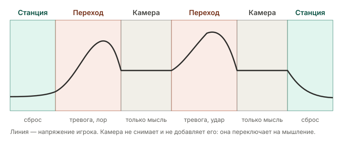

# Структура уровней: переход, камера, станция авангарда

Принято владельцем 2026-11-08 — [ADR-0011](../adr/0011-level-rhythm.md). Канон мира и сектора — [библия](lore/world-bible.md); карточка камеры — [шаблон](puzzle-template.md); пример — [«Петля»](puzzles/loop.md).

Игра строится из двух переплетённых этапов: **исследование** (лор, сюжет, тревога, одиночество, возвращающаяся память) и **головоломки** (только задача). Чтобы им не мешать друг другу, этапы разведены по трём режимам пространства. У каждого режима свой договор с игроком, и нарушать его нельзя: игрок должен по первым секундам понимать, в каком режиме он находится.

Камера не снимает напряжение и не добавляет его. Она переключает игрока с эмоций на мышление. Отдых даёт только станция авангарда.

## Три режима

| | Переход | Камера | Станция авангарда |
| --- | --- | --- | --- |
| Назначение | Лор, сюжет, тревога | Только мысль | Отдых, сброс напряжения |
| Можно | Тела, журналы, аудиозаписи, звук, тьма и фонарь, вспышки памяти, кислород, радиация, редкие постановочные сдвиги помещений | Устройства, кубы, поля, лучи, порталы; запись-гипотеза у входа или выхода | Тёплый свет, кислород, вентиляция, личные следы людей, тихие вспышки памяти, необязательные записи |
| Нельзя | Головоломки сложнее навигации | Угрозы, скримеры, таймеры давления, сюжетные записи внутри, вспышки памяти, кислород, радиация, перестройка | Ничего пугающего — без единого исключения за всю игру |
| Сигнал входа | Выход из шлюза камеры или со станции | Шлюз: звук меняется, свет ровный, дверь закрывается за спиной | Один и тот же ритуал на всех станциях |

Рамки библии сохраняются: кислород и радиация действуют только в переходах; вспышки памяти — между камерами, после решения или при входе в «тихую» зону, никогда во время прыжка, переноса или наведения луча; перестройка помещений — только в переходах, никогда в камере и после её решения; устройства и терминал не лгут, ненадёжна только память.

### Переход

- Здесь работает весь хоррор: масштаб чужого слоя, тишина, следы, тела, звук дозиметра, окна вспышек.
- Сильные сюжетные удары (тело Гезима, пост Илира) ставятся здесь: тревога уже есть, удар её усиливает.
- Навигация читается без подсказок; тупиков и логических задач нет.

### Камера

- **Порог-шлюз.** Отчётливый вход: звук меняется, свет ровный, дверь закрывается. Игрок с первого раза учит, что здесь его никто не тронет.
- **Точка обзора у входа.** Балкон или проём, откуда видны все элементы и их связи: кабели, лампы узлов, рамки полей, створ луча, двери.
- **Без сюжета внутри.** Записи о гипотезах (журнал Илира, по библии на стендах всех секторов) — у входа или выхода.
- Игровой свет отделён от декоративного (ADR-0006): темнота не скрывает обязательных сигналов.

### Станция авангарда

По канону — стойки с кислородом и креплением узла, они же контрольные точки. Чтобы станция ощущалась убежищем:

1. **Ритуал.** Тёплый янтарный свет, шипение кислорода, гул вентиляции, гермодверь за спиной. Один звук входа на всех станциях становится условным рефлексом безопасности.
2. **Человеческий след.** Авангард и экспедиция бывали здесь между сменами: кружка, термос, записка на стойке, личный предмет, необязательная аудиозапись. Лор «тихого» регистра — о людях, а не о тайнах.
3. **Сюжет — дозированно.** На станции место осмыслению: тихой вспышке памяти или записи, заставляющей пересмотреть увиденное. Последняя станция сектора может быть главой с полноценной сюжетной сценой. Остальные станции несут тихие вспышки памяти и личные вещи людей — решение владельца от 2026-11-09. Кнопки дневника памяти на станциях нет.
4. **Взгляд вперёд.** Окно или терминал со схемой следующих камер: игрок отдыхает и предвкушает.
5. **Частота.** Станция через каждые 2–3 камеры: при 8–10 камерах — 3–4 станции на сектор.

Слово «станция» в каноне занято и очистной станцией из прошлого Клетуса. Убежище в документах и интерфейсе всегда называется **станцией авангарда**.

## Принципы головоломок

Цель — принцип Portal и The Talos Principle: решение в основе простое и логичное, но игрок приходит к нему сам, увидев всю логическую картину камеры и сопоставив элементы друг с другом.

1. **Одна идея на камеру.** Ровно одно «ага»; всё остальное игрок уже умеет. Два несвязанных «ага» — признак лишнего или повод разделить камеру.
2. **Всё видно с порога.** Решение строится в голове до первого шага.
3. **Ни одного лишнего элемента.** Если куб в камере, он нужен. Ложные приманки превращают мышление в перебор.
4. **Нехватка ресурса — двигатель задачи.** Кубов меньше, чем мест, где они нужны. «Ага» часто отвечает на вопрос, как одним предметом сделать две вещи.
5. **Очевидное решение почти работает.** Первая идея ломается по видимой причине, и неудача становится подсказкой, а не тупиком.
6. **Честная обратная связь.** Каждое устройство показывает состояние лампой, звуком и формой, не только цветом. Цвета по ADR-0006: циан — луч, янтарь — питание, фиолетовый — поле.
7. **Сложность только в мысли.** Без точных прыжков и жёстких таймеров; понятое решение исполняется за секунды. Тупиков нет: потерянный куб возвращается, камеру можно сбросить.
8. **Обучение → проверка → поворот → сочетание.** Механика показывается в безопасной форме, проверяется, привычное представление о ней переворачивается, и только потом она сочетается с другими.
9. **Наши порталы — стационарные пары с питанием**, а не пушка в руках. Головоломки о том, какую пару запитать, что через неё провести и в каком порядке, — ближе к Talos, чем к Portal.

Проверка: на плейтесте молча наблюдать, где игрок останавливается, что пробует первым и сколько времени уходит до «ага».

## Чек-лист камеры перед сборкой

- [ ] Идея формулируется одной фразой.
- [ ] С точки обзора видны все элементы и связи.
- [ ] Каждый элемент используется в решении.
- [ ] Очевидное ложное решение известно и ломается по видимой причине.
- [ ] Обязательные знания уже даны в предыдущих камерах сектора.
- [ ] Нет требований к точности исполнения; нет тупиков; reset возвращает исходное состояние.
- [ ] Внутри нет угроз, таймеров давления, сюжетных записей и вспышек памяти.
