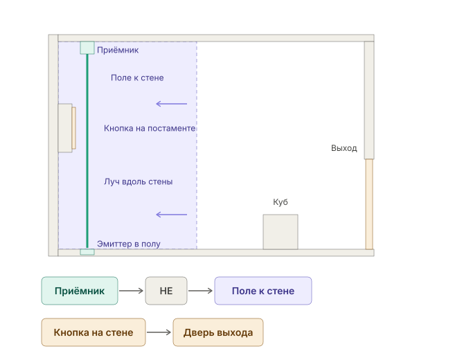
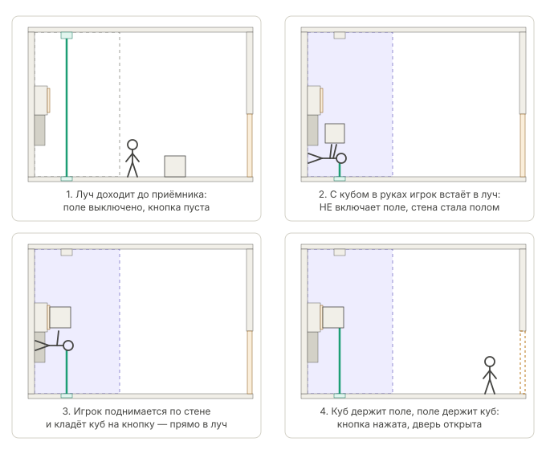

# Камера «Петля»

Пример по [структуре уровней](../level-structure.md). Исходная сцена `content/levels/trial_loop.tscn` (`TrialLoopBuilder`) сохранена как изолированная тестовая фикстура; числа ниже относятся к ней. В меню теперь [единый полигон](mechanics-lab.md): «Петля» встроена в отсек гравитации с высотой 5,5 м и открытым боковым входом, схема прежняя.

- **ID камеры / сектор / версия данных:** `loop` / Сектор 3, Гравитационный узел / 1.
- **Задача roadmap / автор:** LVL-01 (пример), ADR-0011.
- **Вход / выход / обязательные знания:** вход с торца, выход — дверь в дальней перегородке. Знать: игрок перекрывает луч телом; узел НЕ; поле к стене и ходьба по стене; кнопка на стене под кубом.
- **Идея («ага»):** «моё тело выключает приёмник и этим включает поле» → «куб может занять моё место в луче, и тогда петля держит себя сама».
- **Точка обзора:** от входа видны отверстие эмиттера в полу у левой стены, вертикальный луч до приёмника под потолком, рамка поля, постамент с кнопкой на стене на высоте около 3,7 м, куб на полу и закрытая дверь.
- **Цель и условие завершения:** открыть дверь выхода и пройти в неё.
- **Устройства:** `loop.power` (источник), `loop.emitter` (в полу, луч вверх), `loop.receiver` (под потолком, лицом вниз), `loop.not` (НЕ), `loop.field` (поле к левой стене, 4 × 7 × 7 м), `loop.plate` (кнопка 0,8 × 0,8 м на постаменте, порог 8 кг), `loop.door`, балластный куб `CubeA` 0,75 м, 10 кг.
- **Связи:** источник → эмиттер; приёмник → НЕ → поле; кнопка → дверь.
- **Основное решение:** взять куб и встать в луч над эмиттером. Приёмник гаснет, НЕ включает поле, игрок оказывается на стене. Подняться по стене между направляющими до постамента и положить куб на кнопку — она лежит в створе луча. Куб перекрывает луч, поле держит куб на кнопке, дверь открыта. Сойти вбок за край поля, спуститься и выйти.
- **Очевидное ложное решение:** подняться по стене без куба и встать на кнопку самому. Дверь открывается, но стоит сойти с кнопки — закрывается: на кнопке должен остаться куб.
- **Допустимые альтернативы и обходы:** куб, брошенный в луч у пола, полем относит к стене из створа — поле выключается, состояние не держится. С выключенным полем куб на стене не удержать.

- **Обратная связь:** луч виден на всей длине и обрывается на преграде; лампы приёмника, НЕ и кнопки; рамка поля фиолетовая со стрелками к стене; дверь меняет состояние. Сигналы дублируются формой (стрелки поля, лампы), не только цветом.
- **Reset, смерть, checkpoint:** камера без угроз. Если поле выключится, куб и игрок падают на пол — исходная позиция для новой попытки. Тупиковых положений куба нет.
- **Коллизионные ограничения:** капсула игрока поворачивается вокруг центра и требует около 0,9 м от стены, поэтому луч идёт в 1,5 м от стены, а кнопка стоит на постаменте глубиной 0,75 м, чтобы куб на ней перекрывал луч. Направляющие на стене (0,5 м, зазор 0,9 м) начинаются на высоте 1,5 м, выше места поворота, и держат игрока в створе луча. Эмиттер утоплен в шахту: отверстие 0,3 м уже капсулы, срез излучателя на 0,2 м ниже пола (луч, начатый внутри капсулы, её не видит).
- **Перенос через поворот гравитации:** при прежнем захвате (ADR-0007) куб 1 м отпускался, когда игрок поворачивался на стену. Захват в духе Talos ([ADR-0012](../../adr/0012-talos-carry.md)) держит куб в рамке игрока, и поворот его больше не роняет — куда бы игрок ни смотрел. Балластный куб 0,75 м в камере остаётся: под него подобраны постамент, кнопка и расстояние луча от стены.
- **Атмосферные события:** нет (камера).
- **Проверки:** `TrialChamberTests` — покой, ложное решение (поле от тела, подъём по направляющим, кнопка только пока стоишь), основное решение (куб в руках через поворот, петля держится 3 с без игрока, выход); ручной проход — [проверка механик](../../testing.md#пример-камера-петля).
- **Открытые вопросы:** читаемость «встать в луч» без подсказки — на плейтесте; комфорт падения с ~3 м после выхода из поля; перенос куба 1 м через поворот гравитации.
