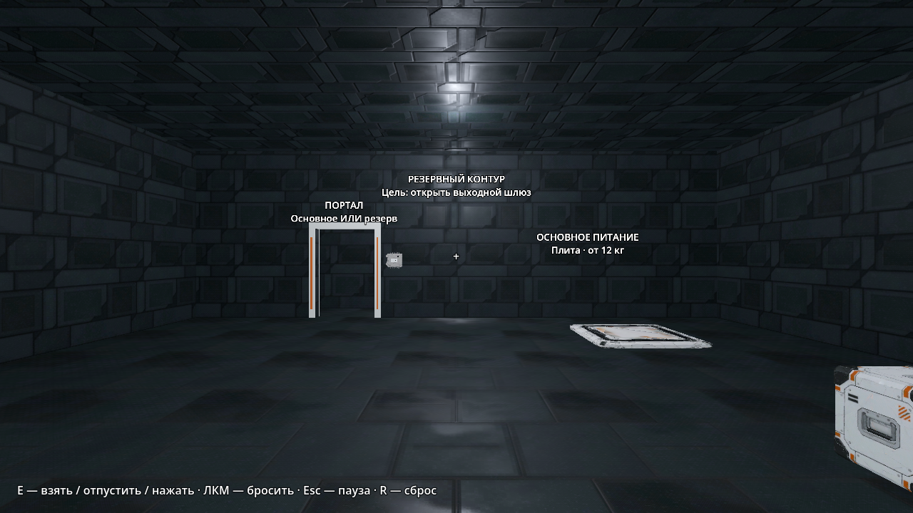

# Комфорт и «Резервный контур» — Windows QA, 12 ноября 2026

База изменений — [`0ca0b52`](https://github.com/hhypest/project-evacuation/commit/0ca0b527e653a76b6dba096e2d33876e65659260). [Предыдущий плейтест и замеры](windows-baseline-0ca0b52-2026-11-12.md) зафиксированы отдельно. Новая камера описана [карточкой с планом и решением](../design/puzzles/reserve-circuit.md).

## Что изменилось

- Текст загрузки с точки входа появляется в главном меню. Пауза возобновляет текущую сессию. R явно подписан как полный перезапуск полигона или камеры.
- Настройки вертикального FOV, чувствительности и длительности поворота при смене гравитации действуют после загрузки и перезапуска. Параметры `user://camera.cfg` и JSON прогресса независимы.
- Короткая подсказка перемещена в нижнюю часть кадра и отключается в настройках. Прицел контрастный, при доступной точной постановке видны силуэт и действие «E — поставить». При взгляде в горизонт куб держится на 7 см ниже. В отсеке света у выхода есть табличка, читаемая при отключённых тестовых источниках.
- Портальный отсев в полигоне использует непрозрачные осевые коробки оболочки портального отсека. Вид выключается лишь когда одна коробка закрывает весь видимый участок. Проёмы, частичное перекрытие и близкий проход остаются в рендере. Это правило камеры, физические границы и пересечение порталов не менялись.

## Новая камера

Целевой проход выполнен на Windows через события Godot и штатную геометрию. Скрипт выбирает вторую камеру в меню, проходит непрерывный маршрут, берёт и ставит оба куба, проходит порталы в обе стороны, нажимает резервный рубильник, достигает сообщения «Испытание пройдено» и проверяет R. Подготовительная перестановка тел или прямое изменение цепей отсутствует. В скрипте задаётся направление камеры, ходьба и взаимодействие идут через обычный ввод.

В исходном состоянии проверены закрытый шлюз и тупик за выключенной рамой. Два сценария с реальным спринтом не проходят закрывающиеся двери. Лёгкий куб удерживает оптическую блокировку открытой, тяжёлый — выход. После перезапуска оба куба, портал, резерв, положение игрока и финальная табличка восстановлены.

[Финиш после переноса балласта](images/comfort-reserve/exit.png).

## Отрисовка скрытых порталов

На обоих коммитах одинаковые позиции камеры, Source (4K/2K), 2560×1440, VSync 180 Гц. Для каждой позиции 10 секунд прогрева, затем 30 секунд CSV, 60 окон на состояние. В колонках времени и вызовов указаны медианы по окнам.

| Поза | Версия | Активные цели | Вызовы отрисовки | CPU отрисовки | GPU отрисовки | FPS |
| --- | --- | ---: | ---: | ---: | ---: | ---: |
| Хаб, проёмы закрыты стеной | `0ca0b52` | 3 | 2 924 | 1,80 мс | 2,05 мс | 179,87 |
| Хаб, проёмы закрыты стеной | `3ff8dd5` | 1 | 1 173 | 0,70 мс | 1,80 мс | 179,87 |
| Оба проёма в кадре | `0ca0b52` | 3 | 1 641 | 1,27 мс | 2,10 мс | 179,88 |
| Оба проёма в кадре | `3ff8dd5` | 3 | 1 671 | 1,28 мс | 2,09 мс | 179,87 |

В хабе работают основной кадр и физика, оба портальных вида отключены. В отсеке 06 оба вида продолжают обновляться. FPS в этих сериях ограничен VSync. Приостановка обновления сохраняет выделенные текстуры порталов, чтобы повторное появление в кадре обходилось без перевыделения.

## Проверки

Windows 11 Pro 26300, i5‑14400F, 32 ГБ, RTX 4070 Ti SUPER, драйвер `32.0.16.1742`, Vulkan 1.4.351 / Forward+, Jolt 60 Гц, Godot 4.7.2 Standard.

| Набор | Результат |
| --- | --- |
| `tools/check.ps1` | 171 скрипт, проверка зависимостей 112 скриптов. По 406/406 при обычной отрисовке и при фиксированных 30 и 144 FPS. Время наборов 317,34 / 26,01 / 99,25 с. Полный проход камеры потребовал увеличить прежний лимит 300 с до 360 с. |
| Полный проход камеры | 13/13 в целевом headless-сценарии и 13/13 в оконном Vulkan 1280×720 на RTX. Лог завершения — `CHAMBER_COMPLETED level=reserve_circuit`. |
| Регрессии Vulkan | GPU-сценарий, проход порталов, нативная картинка, край, свет и профилировщик прошли. Измеренное отклонение яркости тени осталось 0,4622. |
| Windows-экспорт `3ff8dd5` | 19/19 в `--runtime-smoke` отдельно в headless и Vulkan. В обычном окне выбрана вторая камера, проверена пауза после Alt+Tab и загружен её вход после закрытия и нового запуска. FOV 77° и выключенная подсказка сохранились в изолированном профиле. |
| Дистрибутив | Windows и Linux экспортированы. Хеш Windows `evacuation.exe` сверён с manifest и содержимым ZIP: `f7412075b52f932e34aa2b2be85ca53d5575916f401785949e0b5464d87687dc`. |

Полное прохождение выполнено событиями движка. В Windows-экспорте также проверены штатные меню, пауза и загрузка с диска. Физическая клавиатура, запуск Linux на целевой ОС и человеческая оценка сложности и субъективного комфорта остаются открытыми.
