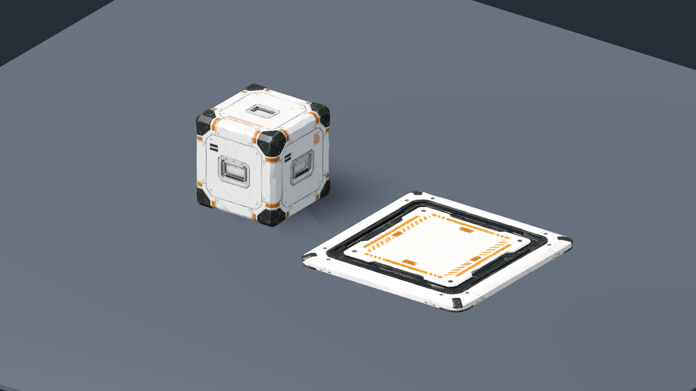

# Куб и напольная кнопка по концептам — 2026-11-09

## Объём

По поручению владельца заменены модели и текстуры куба и напольной кнопки из PR №30. Референсы — DEV-01/DEV-02 из `Abandoned_Meshy_Concepts.zip`, страницы 9/10 `Abandoned_Meshy_Catalog.pdf`. Остальные устройства и механики не расширялись. Выполнено локально в ветке `art/concept-cube-floor-button` от `0655341`.

Генератор — Meshy Image to 3D 7.1, геометрия 2K, remesh с ориентиром 25 000 треугольников, PBR 4K. Текстура куба очищена через Meshy Image to Image и Retexture с сохранением UV: надпись `MASS 12.5T` из концепта не является игровой массой. Фактический расход — 84 кредита. Полные параметры, ID и хеши — в [реестре](../../content/models/cube-floor-button-2026-11-09.json), лицензия и ограничения — в [описании моделей](../../content/models/README.md).

## Подготовка и интеграция

- Куб: 23 752 треугольника, габариты ровно 1 × 1 × 1 м, pivot в центре. Существующие `PropVisuals.ballast_cube` и `TestCube` загружают новую модель по прежнему пути; куб «Петли» масштабируется до 0,75 м.
- Кнопка: 20 326 треугольников в `Frame`, 3 203 в `Plate`. Видимая плита ≈1,39 м внутри коллизии 1,4 м, верх на 0,1 м. Режим `button_concept` отделяет также боковины плиты; ход — 3 см. Тёмный канал и светлая рамка неподвижны. Четыре отдельные полосы светятся только при выходном сигнале.
- Нормализатор сохраняет исходные байты JPEG/PNG с правильным расширением. На текстурах включены VRAM-сжатие и mipmaps, на normal maps — импорт нормалей.
- Фактическое разрешение карт у обеих моделей: albedo/normal — 4096 × 4096, metallic/roughness — 2048 × 2048, несмотря на общий параметр генерации `texture_resolution=4k`.
- Коллизии, масса тел, датчики нагрузки, пороги, состояние сети и входы устройств не менялись. Рамка новой модели декоративная, ≈2,02 м против прежних 1,66 м; не использовать её как физическую поверхность.

## Свидетельства

Среда: официальный Godot `4.7.2.stable.official.ed1daf0bf`, Jolt, Vulkan 1.4.351, Forward+, NVIDIA GeForce RTX 4070 Ti SUPER.

| Проверка | Результат |
| --- | --- |
| Исходный `tools/check.ps1` до замены | 229/229, 112 скриптов |
| `tools/check.ps1` после замены | 229/229, 113 скриптов; проверка слоёв и отказов runner прошла |
| Общая ветка с оптикой перед PR | 232/232; integration с `--fixed-fps 30` и `144` — по 105/105 |
| Финальный `--check-only` для `tools/art/device_models_smoke.gd` | Без ошибок |
| `tools/art/device_models_smoke.gd` на реальном GPU | `DEVICE_MODELS_SMOKE_PASSED`; проверены размеры, pivot, масштаб, коллизия, ход и возврат плиты, неподвижность рамки и отсутствие физики в моделях |
| `tools/gpu_smoke.gd` на реальном GPU | `GPU_SMOKE_PASSED`; меню, ввод, пауза/фокус/reset, движение, захват/удержание/бросок куба, кнопка/дверь, луч и поле/ходьба по стене |
| Кадры до/после, крупные планы, покой/нажатие, вид сверху | Сняты и просмотрены; тёмный канал остаётся на рамке, ложная маркировка массы удалена |

Логи сохранены локально в `work/concept-check.log`, `work/concept-gpu.log`, `work/concept-model-smoke.log`; кэши и логи в Git не включаются. Повторный запуск просмотра: `godot --path . --script tools/art/device_models_smoke.gd -- --capture work/device-models.png`.

## Границы приёмки

Ручное прохождение владельцем после замены, художественная приёмка, экспорт и отдельный замер производительности этой ревизии не выполнены. Автоматический набор решает камеры и проверяет физические контакты, но не заменяет оценку нового силуэта в движении. Карты 4K требуют больше места и видеопамяти, чем прежние 2K. Скрытые стороны объектов достроены Meshy по одному изображению; мелкая асимметрия сохраняется.
