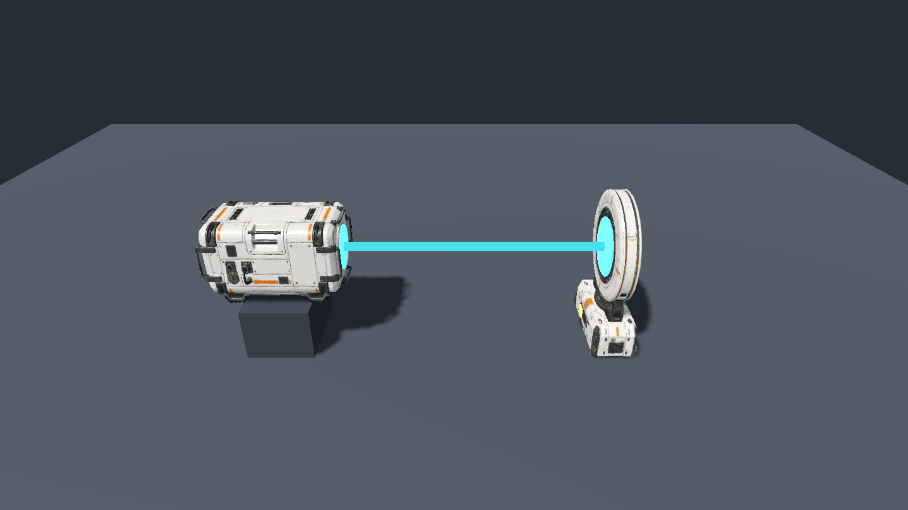

# Эмиттер и приёмник по DEV-05/DEV-06 — 2026-11-09

## Объём и происхождение

По поручению владельца заменены модели и текстуры эмиттера/приёмника из PR №33 на результаты Meshy по изображениям DEV-05/DEV-06 каталога `Abandoned_Meshy_Concepts.zip`. Работа продолжает локальную ветку `art/concept-cube-floor-button`; изменения куба и кнопки сохранены.

Референсы сначала подготовлены через Meshy Image to Image: погашены линзы и убрана псевдомаркировка, сохранены конструкция и палитра. Затем Meshy Image to 3D 7.1, геометрия 2K, remesh с ориентиром 25 000 треугольников. Фактически albedo/normal — 4096 × 4096, metallic/roughness — 2048 × 2048. Расход — 78 кредитов. Полные запросы без ключей/временных URL, ID и SHA-256 — в [реестре](../../content/models/emitter-receiver-2026-11-09.json).

Модели и карты входят в прежнюю область лицензии MIT для `content/models/devices` по принятому решению владельца. Изображения каталога не включены в репозиторий. Концепты определяют внешний вид, не новые правила или игровые размеры.

## Интеграция

- Эмиттер: 23 935 треугольников, модель 0,5 × 0,433 × 0,7 м, прежняя коллизия 0,5 × 0,5 × 0,7 м. Режим нормализации `emitter_concept`; рабочая линза на оси −Z, радиус 0,116 м, z = −0,331 м. Видимый луч начинается у линзы; физический muzzle и трассировка прежние.
- Приёмник: 24 256 треугольников, модель 0,6 × 0,808 × 0,25 м, прежняя коллизия 0,6 × 0,6 × 0,25 м. Режим `receiver_concept` сохраняет круглый обод; основание расположено ниже оптической оси. Световой диск на z = 0,125 м совпадает с плоскостью физического попадания. Лампа размещена на основании.
- Квадратная светящаяся рамка заменена круглой кромкой. Линза эмиттера включается от питания; линза, кромка и лампа приёмника — только от принятого попадания. При перекрытии луча приёмник гаснет, эмиттер остаётся включённым. Кадры покоя сняты с выключенными индикаторами, а не с нарисованным в текстуре цианом.
- Каналы, конус приёма, антидребезг, дальность, сеть, reset и физические тела не менялись. Все уровни загружают новые модели через прежние классы и пути.

## Проверки

Среда: Godot `4.7.2.stable.official.ed1daf0bf`, Jolt, Vulkan 1.4.351, Forward+, NVIDIA GeForce RTX 4070 Ti SUPER.

| Проверка | Свидетельство |
| --- | --- |
| Типы и слои | 114 скриптов, 80 скриптов в проверке слоёв |
| `tools/check.ps1` | 232/232, `failed=0`, 159 769 мс; отрицательные сценарии runner также прошли |
| integration с `--fixed-fps 30` и `144` перед PR | 105/105 в каждом прогоне; 32 071 и 66 220 мс |
| `tools/art/optics_models_smoke.gd` | `OPTICS_MODELS_SMOKE_PASSED` на RTX: исходные коллизии, отсутствие физики в моделях, оптические центры на оси луча, видимый отрезок от линзы до линзы; настоящий raycast попадает в приёмник и затем в добавленную преграду |
| `tools/gpu_smoke.gd` | `GPU_SMOKE_PASSED` на RTX: меню/пауза/фокус/reset, движение, перенос/бросок куба, кнопка/дверь, луч и гравитация |
| Состояния в сцене | Сняты и просмотрены кадры: выключено, попадание, перекрытие, крупные планы обоих устройств |
| Новые интеграционные сценарии | Незапитанные поверхности не светятся; принятое попадание включает линзы; преграда гасит приёмник при включённом эмиттере |

Команда просмотра: `godot --path . --script tools/art/optics_models_smoke.gd -- --capture work/optics-models.png`. Скрипт просмотра проверяет визуальные адаптеры и реальные raycast, но сам вручную задаёт отображаемые состояния; работу настоящей сети, конус, перекрытие игроком/кубом, reset и дверь проверяет `BeamDeviceTests`. Логи этой ревизии — `work/optics-check.log`, `work/optics-gpu.log`, `work/optics-model-smoke.log`.

## Ограничения

Художественная приёмка и ручное прохождение владельцем этой ревизии, экспорт и отдельный замер стоимости кадра не выполнены. Скрытые стороны достроены Meshy; торцы эмиттера и оптический мотив обратной стороны приёмника симметричны. Декоративное основание приёмника ниже коллизии примерно на 21 см и впереди неё на 7,5 см; оно не становится новой физической опорой. Его глубина подогнана под прежний игровой габарит. Карты 4K увеличивают место и расход видеопамяти.

Внешний рабочий план `models-generation-plan.md`, версия 1, описывал 2K-текстуры и кольцо из 12 сегментов. Эта ревизия следует выбранным владельцем концептам DEV-05/DEV-06: цвет/нормали 4K и цельная круглая световая кромка. План не копируется в репозиторий и не меняет согласованный объём этого PR.
