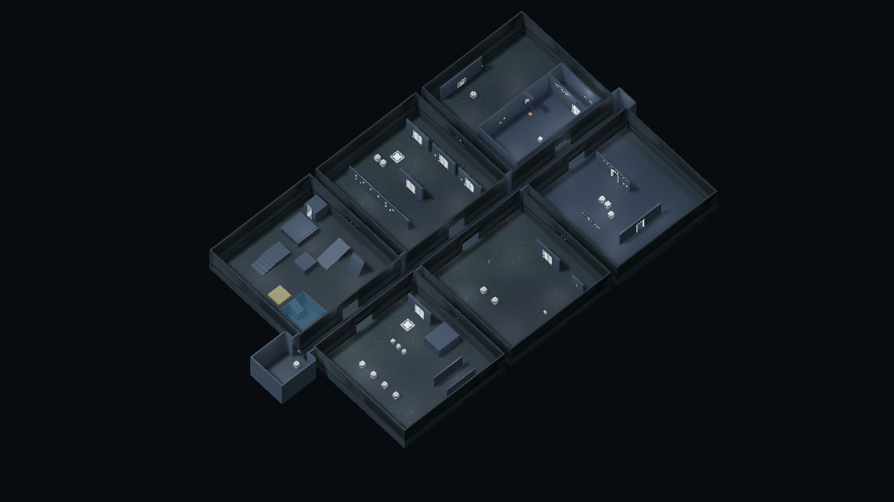
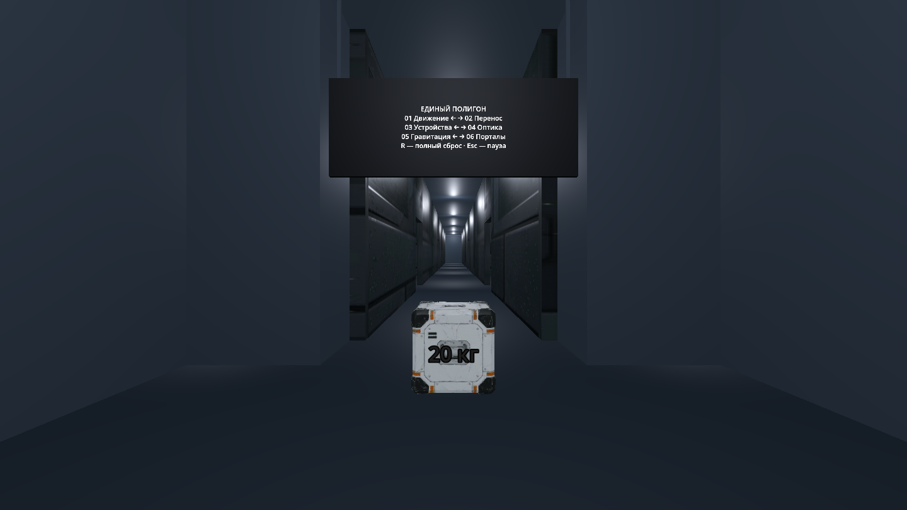
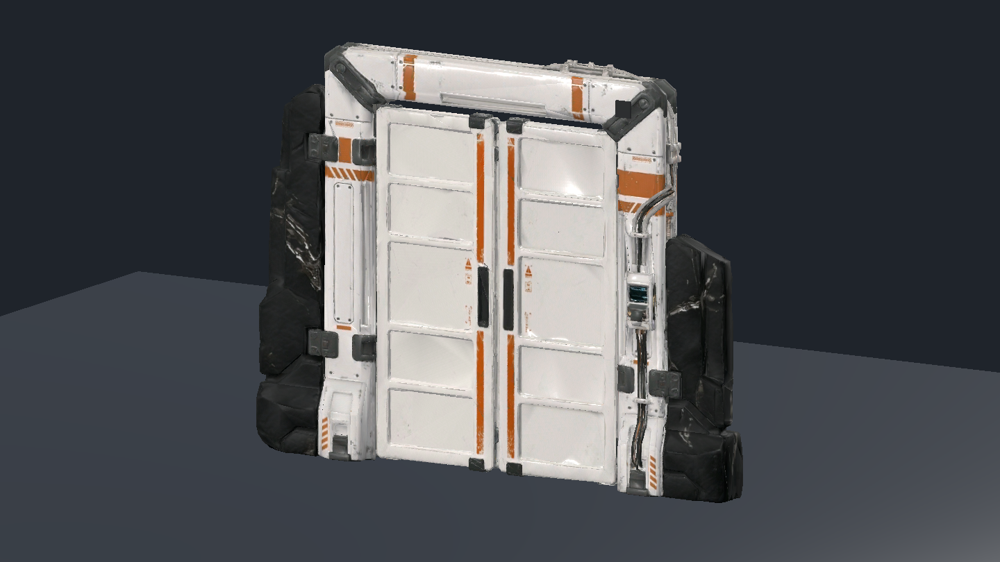
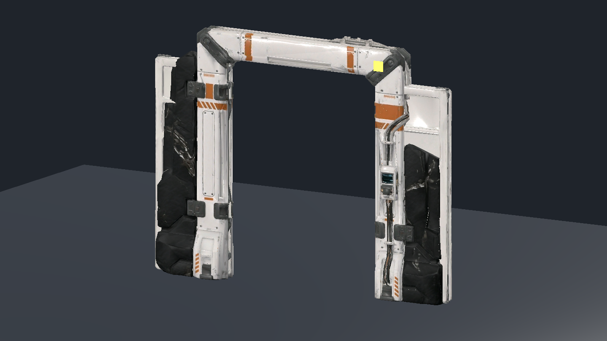

# Двери, 4K PBR и единый полигон — 2026-11-11

Ветка `codex/doors-unified-mechanics`, база `948aba23b6d932280b61933ed0b428e602073bdc` после PR №46. Версия игры — 0.0.10-dev. [План полигона](../design/puzzles/mechanics-lab.md) · [реестр ресурсов, параметров и SHA-256](../../content/models/doors-and-4k-2026-11-11.json).

## Ресурсы

Согласованы цвет/нормали 4K и native metallic/roughness 2K, две раздвижные створки, независимые отсеки и предел Meshy 150 кредитов с одним возможным платным повтором. Выполнены три Retexture по 10 и две Image to 3D по 35 кредитов: **100 кредитов**, повторов **0**. Реестр содержит все пять ID, исходные параметры, хеши двух приложенных JPG и полученных GLB. Сами референсы и авторизационные данные в репозиторий не включены.

DEV-03/04/07 получили только новые изображения. Их игровые `.bin` побайтово совпадают с main; узлы, UV и шарниры сохранены. Возвращённая Meshy геометрия и её нормали не используются. Исходные UV провайдера проверены на совпадение перед заменой карт.

DEV-12 приведён к игровому проёму через Blender 4.3.2: Exact Boolean очищает отверстие 2 × 2,6 м сквозь всю глубину, затем рама разделяется на стойки и перемычку. После Float32-экспорта удалены вырожденные треугольники; нулевые нормали на срезах заменены геометрическими. Рама — **23 022**, створка DEV-13 — **12 977** треугольников. Все **25 файлов пяти комплектов** воспроизводятся побайтово; координаты/UV конечны, нормали единичные, вырожденных треугольников нет.

Source/2K расширен до **27 карт девяти комплектов**. Оба профиля прошли проверку фактически загруженных `Texture2D`; финальный профиль — **Source**. Цвет и нормали всех комплектов имеют 4096 × 4096, MR — 2048 × 2048. Исходные пиксели при переключении профиля не меняются.

## Полигон и совместимость

Единственная сцена меню — `MechanicsLab`: шесть отсеков и постоянный коридор. Сохранены корневые `Player`/`Camera`, API сессии, физика и правила устройств. У дверей прежние примитивные коллизии, скорость, вход питания и защита занятого проёма. Рама не добавляет физические тела; модульные части поддерживают другие размеры проёма.

Старые сцены остались фикстурами. Тесты испытаний используют явные ссылки, а GPU-smoke, портальная проверка, проверка профилировщика и экспортированный runtime-smoke переведены на новый полигон. Регрессия перезапуска сравнивает новую позицию куба со стартовой с допуском 0,1 м для оседания в физике; точная позиция между render/physics кадрами не является контрактом.

## Проверки

Среда: Debian 13 x86_64; официальный Godot **4.7.2.stable.official.ed1daf0bf**, проверенный по SHA-512; PowerShell 7.5.4. Графические проверки используют **Vulkan 1.4.305 / Forward+ / llvmpipe (LLVM 19.1.7)** через Xvfb, аудиодрайвер Dummy. Это программный Vulkan, не GPU владельца.

Подтверждены:

- `UnifiedLabTests`: **14/14**, включая капсульный проход ко всем входам, настоящую глубину бассейна, всплытие и физический выход по ступеням, независимость цепей, нагрузку, занятый проём, оптику, комбинированную петлю и повторную загрузку.
- `tools/check.ps1`: **357/357** на обычной cadence, **357/357** при 30 FPS и **357/357** при 144 FPS; проверки слоёв, типов, отрицательного exit code и аргументов завершились `CHECKS_PASSED`.
- Стандартный проём и увеличенный **3 × 3,2 м**: лучи с обеих сторон не встречают декоративную геометрию рамы внутри чистого прохода.
- Регрессии сессии на обычной cadence: **20/20**.
- `DOOR_MODELS_SMOKE_PASSED`: обе стороны закрытой/открытой двери, ход створок и прежние коллизии. `WALL_DEVICES_SMOKE_PASSED`: обновлённые текстуры, клавиша/рукоять и шесть типов логических узлов. Изолированные арт-сцены — окно 1440 × 1000.
- `MECHANICS_LAB_SMOKE_PASSED`: обзор и все шесть отсеков в Vulkan, окно 1440 × 1000.
- `PORTAL_SMOKE_PASSED`, окно **640 × 360**: виды с двух сторон, близкий косой вид (58 переходов контрольного узора), две половины куба, перенос куба и проход игрока с удерживаемым кубом через реальные E/W/Shift/мышь.
- `PROFILER_SMOKE_PASSED`, окно 320 × 180: F3/F4, пауза/фокус, GPU counters, 14 строк CSV, учёт портальных SubViewport и пересоздание сцены.
- `tools/export.ps1`: **Windows Vulkan + Linux Vulkan** с notices и provenance от чистого коммита `ea4edbce53f9c132fe2ca989a6a7cb662af40e2b`. Экспортированные игровые файлы соответствуют реализации PR; последующие изменения касаются только QA-документа. Linux release: **16/16**, `EXPORTED_GAMEPLAY_SMOKE_PASSED` (headless/Jolt); намеренный сбой завершился ожидаемым exit 1. Windows исполняемый файл собран, его запуск здесь не проверялся.
- Повторное изготовление **25/25** файлов и проверка всех **27** карт в Source и 2K.

`GPU_SMOKE_PASSED` на Vulkan: реальный клавиатурный/мышиный ввод, пауза/фокус/перезапуск, перенос/бросок/постановка, кнопка и двери, луч, гравитация. Окно **320 × 180**: llvmpipe не укладывается в лимит при 1280 × 720 на полной сцене с активными порталами. Это свидетельство поведения и рендера, не замер аппаратного FPS.

Ограничение времени общего GPU-smoke увеличено с 45 до 180 секунд: проверяется большой единый уровень с активными порталами и холодным стартом программного Vulkan. Проверки поведения и требование Vulkan сохраняются; программа печатает достигнутые этапы.

Проверка документации: **99 Markdown-файлов, 918 локальных ссылок, 430 сохранённых якорей**, ошибок нет. `git diff --check` и скан изменённых текстовых файлов на шаблоны секретов чистые.

## Изображения

Обзор снят с фактической загруженной сцены; только для этого инспекционного ракурса скрыты крыши. В обычной игре потолки присутствуют.

Остальные ракурсы: [движение](images/doors-mechanics/mechanics-movement.png), [перенос](images/doors-mechanics/mechanics-carry.png), [устройства](images/doors-mechanics/mechanics-devices.png), [оптика](images/doors-mechanics/mechanics-optics.png), [гравитация](images/doors-mechanics/mechanics-gravity.png), [порталы](images/doors-mechanics/mechanics-portals.png), дверь [сзади закрытая](images/doors-mechanics/doors-back-closed.png) и [открытая](images/doors-mechanics/doors-back-open.png).

Обновлённые настенные устройства: [выключены](images/doors-mechanics/walls-4k-off.png), [включены](images/doors-mechanics/walls-4k-on.png). Порталы: [сторона A](images/doors-mechanics/portals-a.png), [сторона B](images/doors-mechanics/portals-b.png), [близкий контрольный узор](images/doors-mechanics/portals-quality-crop.png), [две половины](images/doors-mechanics/portals-half-0.png), [игрок с кубом после прохода](images/doors-mechanics/portals-player-held.png).

## Остаток

Художественная приёмка, ручной обход владельцем и комфорт/FPS на его RTX ещё не проверены. Программный Vulkan не доказывает аппаратную производительность. Псевдомаркировка в текстурах не используется как инструкция; экран рамы декоративный. Предел — одна пара порталов на уровень. Перезапуск общий, локальных сохранений/сбросов отсеков нет.
