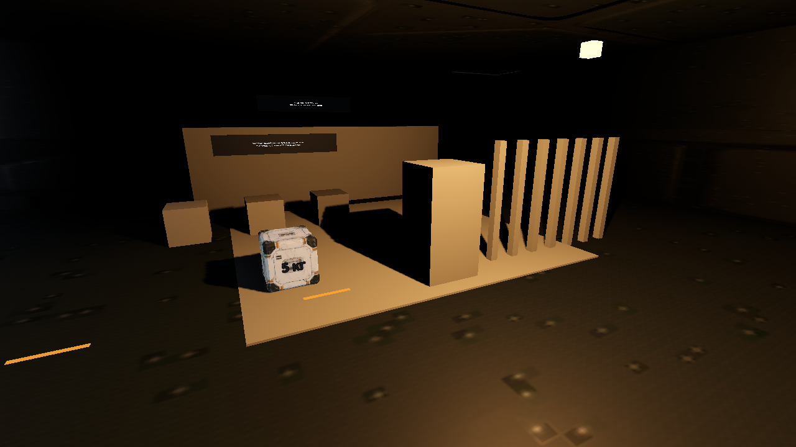
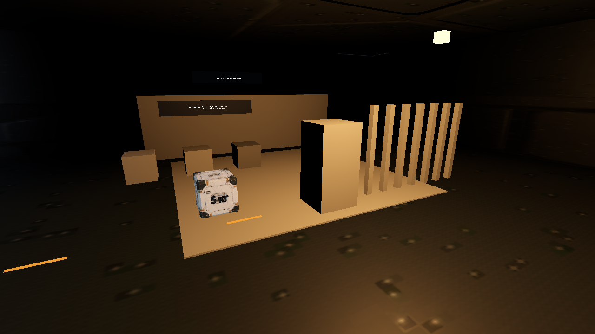
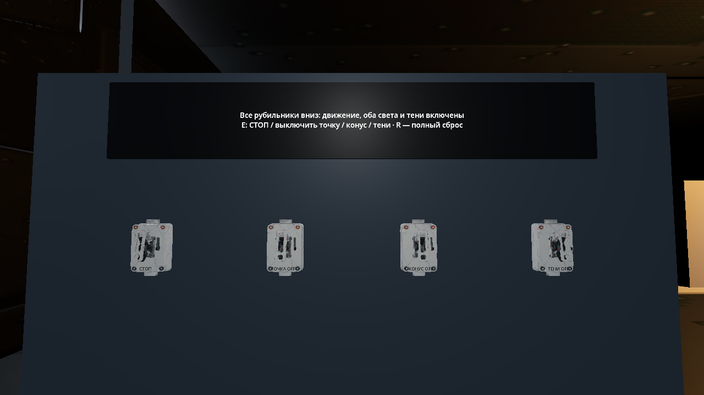
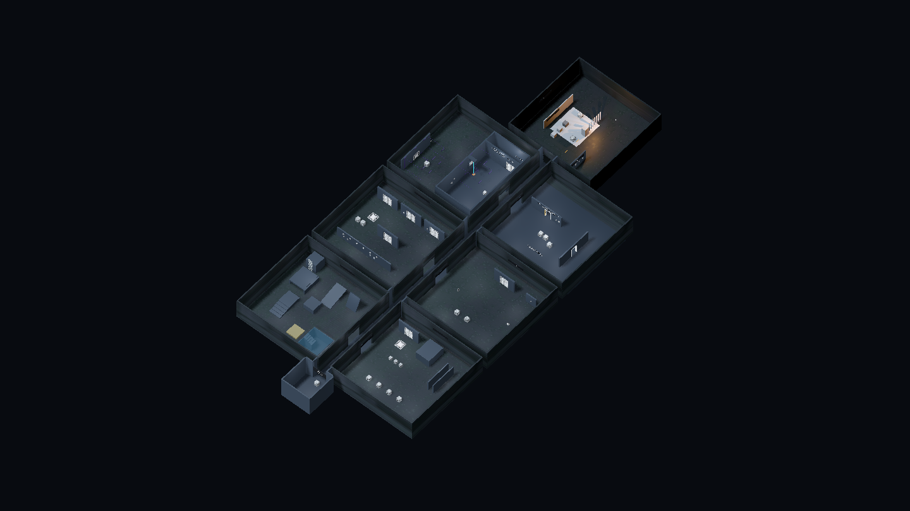

# Комната освещения и актуализация документации — 2026-11-11

База — `81d6791` (main после PR №47), ветка `codex/lighting-room-docs`, версия 0.0.10-dev. [Карта сверки документации](../maintenance/codebase-sync-2026-11-11.md) · [комната и управление](../design/puzzles/lighting-room.md).

## Изменение

Седьмая комната присоединена к концу существующего коридора. Добавлены движущаяся точка, независимый прожектор, преграды, переносимые кубы, образцы материалов и четыре сетевых рубильника. Их выходы не влияют на другие отсеки. Обычные коллизии/ввод/Jolt, пауза, перезапуск и единственная портальная пара сохраняются.

Действующие документы сверены с исходниками и историей main. Уточнены объём полигона и профиля текстур, фактический reset, отсутствие JSON/checkpoint/LevelDefinition и границы диагностики. Старые QA не переписываются под новые результаты.

## Проверки

Среда: Debian 13 x86_64, официальный Godot 4.7.2 Standard `ed1daf0bf`, PowerShell 7.5.4. Рендер: Vulkan 1.4.305 / Forward+ / llvmpipe LLVM 19.1.7 через Xvfb; аудиодрайвер Dummy. Это программный рендер, не видеокарта владельца.

Подтверждены `UnifiedLabTests` **20/20** на Jolt: семь отсеков и одна пара, капсульный маршрут к новой комнате, прежние механики, независимые световые переключатели через луч взаимодействия, остановка/продолжение, пауза и повторное открытие с исходным состоянием.

`tools/lighting_smoke.gd` завершился `LIGHTING_SMOKE_PASSED` в окне **1280 × 720**. Загружена настоящая сцена полигона, крыши и препятствия сохранены. Через игровой сценарий взаимодействия переключены рубильники; для воспроизводимого сравнения точка затем поставлена в фиксированную позу. На одинаковом ракурсе включение теней уменьшило яркость контрольной площадки за колонной на **0,4624** (средняя luminance 5 × 5 пикселей, максимальная разница девяти заранее заданных участков; порог 0,04). Это подтверждает изображение тени, а не только свойство `shadow_enabled`. Сохранены шесть кадров: пульт, точка с тенями/без, прожектор, оба источника и выключенные тестовые источники. `tools/mechanics_lab_smoke.gd` также завершился `MECHANICS_LAB_SMOKE_PASSED`: хаб, общий обзор и семь отсеков.

`tools/check.ps1` завершился `CHECKS_PASSED`: слои **103** production-скриптов, синтаксис/типы **155** скриптов, **363/363** при обычной cadence (260,1 с), **363/363** при 30 FPS (18,2 с) и **363/363** при 144 FPS (55,9 с), физика 60 Гц. Отрицательные проверки runner/аргументов прошли. Последняя правка GPU-инструмента дополнительно исполнена реальным Vulkan-прогоном.

`python tools/check_docs.py`: **102** Markdown-файла, **970** локальных ссылок, **430** сохранённых якорей, **37** внешних URL, ошибок 0. `git diff --check` чистый; шаблоны секретов в изменённых текстах не найдены.

Команды из корня checkout (PowerShell, `GODOT_BIN` — закреплённый редактор):

```powershell
./tools/check.ps1 -GodotPath $env:GODOT_BIN
& $env:GODOT_BIN --path . --script tools/lighting_smoke.gd -- --capture work/lighting.png
& $env:GODOT_BIN --path . --script tools/mechanics_lab_smoke.gd -- --capture work/mechanics.png
python tools/check_docs.py
```

Экспорт выполняется после фиксации чистого исходного дерева; результат будет записан отдельным уточнением QA.

## Изображения

Свет и преграды сняты с фактически загруженного уровня. Только на общем обзоре скрыты крыши, затем возвращены; игровые световые ракурсы сняты с потолком.







Остальные состояния: [прожектор](images/lighting/lighting-spot-shadows.png), [оба источника и движение](images/lighting/lighting-moving-both.png), [тестовые источники выключены](images/lighting/lighting-sources-off.png), [вид от входа](images/lighting/mechanics-lighting.png), [хаб](images/lighting/mechanics-hub.png).



## Остаток

Новый свет не проверен на аппаратном GPU/Windows и не принят владельцем визуально. Скриптовое взаимодействие и капсульный запрос маршрута не заменяют ручной обход от хаба. Программный Vulkan не доказывает целевой FPS; нужен одинаковый ракурс и F3/F4 на RTX. Тестируется прямой свет, не GI/lightmaps или финальная атмосфера кампании.
