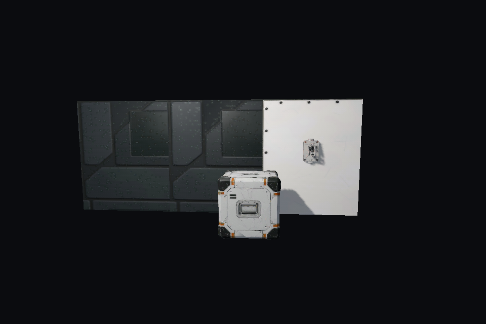
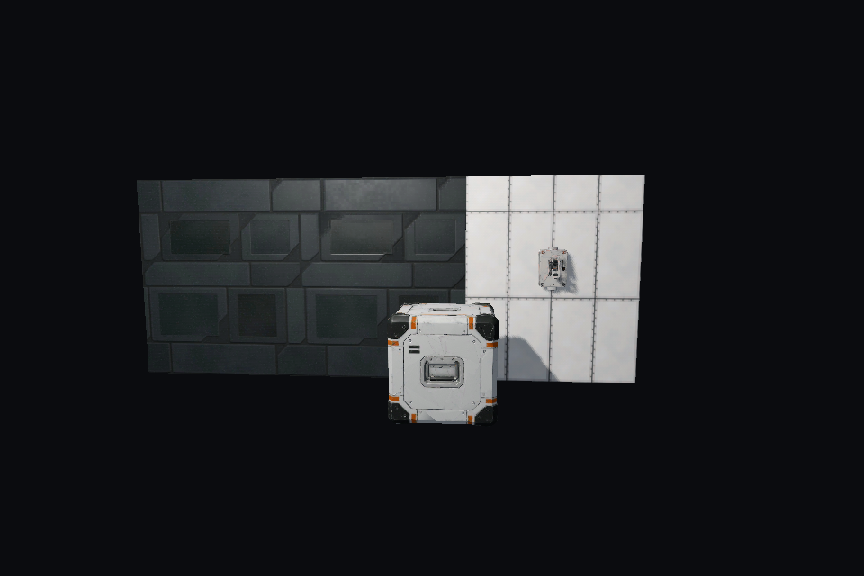
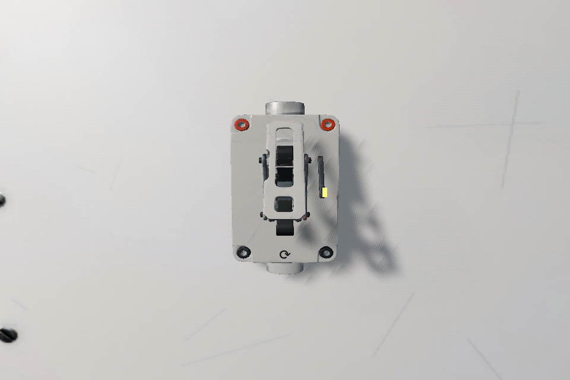
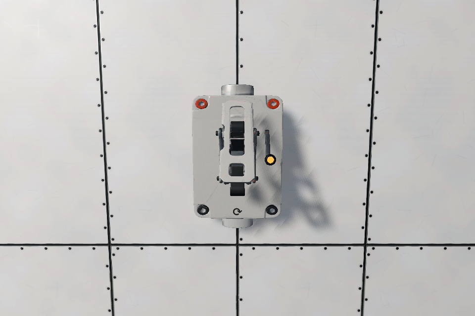
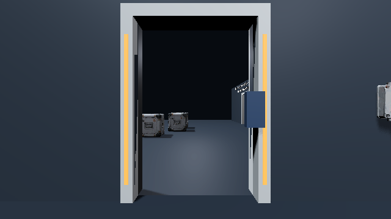
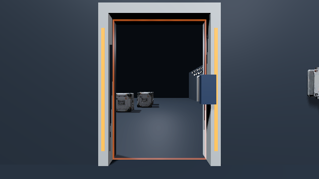
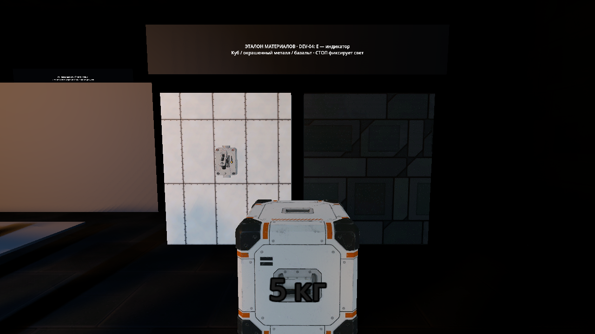

# Край порталов, DEV-04 и эталон материалов — 2026-11-12

База: `12e71367fa0f8792f9a9dd9d7bf4c9fee35ff06c`, ветка `codex/portal-rim-material-reference`, Godot **4.7.2.stable.official.ed1daf0bf**, игра 0.0.10-dev. [Реестр исходников, SHA-256 и прав](../../content/models/material-reference-2026-11-12.json). Изменение — первый образец SLICE-02, художественная приёмка открыта.

## Что исправлено

- `BoxMesh` растягивал фиксированный UV-атлас на всю грань, включая стены длиной 24,6 м. `MetricBoxMesh` сохраняет геометрию, но задаёт 2 м на тайл и общую фазу соседних модулей. Тангенты пересчитываются для новых UV. Эталон `panel_light` использует 1 м на тайл.
- У обычного куба включены анизотропная фильтрация и запрет повторения атласа. Портальные половины получают те же PBR-карты, параметры и ограниченные координаты выборки. Изображения не увеличивались и не перерисовывались.
- DEV-04: прокладка, округлый металлический ободок и матовая непрозрачная линза ниже переднего края ободка. Посадка опирается на измеренный корпус (z до 0,0594 м в зоне индикатора). Включение даёт янтарную emission 1,1; выключение оставляет материал линзы. Шарнир, коллизия и сеть прежние.
- Мембрана: полоса 4 см внутри прямоугольного края, медленный шум, цвет `accent`, интенсивность 0,65. Источник — `portal_image`; центр не искажается. Прежние экранные лучи, отсечение и глубина сохранены. Дополнительных целей рендера или прозрачных проходов нет.
- В комнате 07 размещены панель с рабочим DEV-04, базальт и переносимый куб. E переключает индикатор, СТОП фиксирует свет, R пересоздаёт полигон.

## Проверки

Среда: Debian 13 x86_64, Jolt, **Vulkan 1.4.305 / Forward+ / llvmpipe LLVM 19.1.7**; Xvfb. Редактор и export templates проверены по закреплённым SHA-512. Это программный Vulkan, не GPU владельца.

- `tools/check.ps1`: **383/383** при обычной cadence, **383/383** при 30 FPS, **383/383** при 144 FPS; `CHECKS_PASSED`. Новые шесть проверок охватывают плотность UV/стыки, нормали/тангенты, прежние габариты, идемпотентность индикатора, отсутствие физики в его арте и PBR/выборку портальных половин. Изменённые после общего прогона графические инструменты дополнительно проверяются движком и запускаются отдельно.
- `tools/portal_view_smoke.gd`: **PORTAL_NATIVE_PASSED**, 1280×720. Восемь близких косых видов дают 101–165 переходов контрольного узора. Ошибка RGB освещения: A **0,00348**, B **0,00147**, предел 0,012.
- `tools/portal_smoke.gd`: **PORTAL_SMOKE_PASSED**, 640×360. Обе стороны, близкий вид, две половины куба, перенос куба и игрока с удерживаемым предметом через E/W/Shift/мышь.
- `tools/portal_rim_smoke.gd`: A/B изображения с нулевой и рабочей интенсивностью; у обеих сторон средняя ошибка центра **0,000000**, изменено **3040** пикселей края, ошибка закрытого предметом участка **0,000000**.
- `tools/art/material_reference_smoke.gd`: одинаковые перспективная камера и свет до/после, DEV-04 спереди и под углом 0,85 рад, включён/выключен, яркий/слабый свет, куб под светом с двух сторон.
- `python tools/art/audit_material_reference.py`: у DEV-01 23 752 треугольника, без вырожденных геометрических/UV-треугольников, единичные нормали. Плотность 4K-атласа p10/median/p90 ≈ **818/1224/2072 текселей/м**. У исходного DEV-04 найдены два вырожденных UV-треугольника корпуса; правка исходных UV и запекание отнесены к следующему этапу после приёмки образца.

- `tools/lighting_smoke.gd`: **LIGHTING_SMOKE_PASSED**, 1280×720; падение яркости тени 0,4624. Эталон проверен в реальной комнате: E включает линзу, reset сети выключает её. После визуальной проверки образцы перенесены правее экрана-преграды, в область досягаемости существующего света; повторная проверка сцены и шести новых контрактов — **26/26**.
- Source/2K: **27/27** загруженных карт проверены в каждом профиле. Перспективная матрица эталона прошла на обоих профилях; конечный профиль — **Source**, исходные пиксели сохранены.
- Короткое A/B на llvmpipe, по 30 кадров на состояние: draw calls и оценка памяти **не меняются** при включении эффекта. Для A — 117 вызовов, для B — 71; суммарное GPU-время viewport A 179,41 → 180,45 мс, B 143,50 → 144,90 мс. Разница коротких программных замеров не доказывает ускорение/регрессию на RTX. [CSV](portal-rim-metrics-2026-11-12.csv).

Первый запуск native-проверки упёрся в прежний лимит 60 с при холодном программном Vulkan. Лимит увеличен до 180 с, проверки не ослаблены; повторный запуск завершился успешно. В игровом smoke размер окна теперь задаётся после полноэкранной настройки Main: фактический захват действительно 640×360. Ошибка логических/физических координат в новом A/B-инструменте исправлена до успешного результата.

## Сравнения

Одинаковые ракурс, свет, размер окна и профиль Source. Изолированный стенд воспроизводит материалы и построение поверхностей реального полигона.

| До | После |
| --- | --- |
|  |  |
|  |  |
|  |  |

Слабый свет и боковой обзор: [выключен](images/material-reference/after-material-switch-dim-0.85-off.png), [включён](images/material-reference/after-material-switch-dim-0.85-on.png).

Эталон в игровом отсеке после проверки доступности и ракурса:



Реальное взаимодействие: [выключен](images/material-reference/lighting-reference-off.png), [включён](images/material-reference/lighting-reference-on.png). Сравнение профиля: [Source](images/material-reference/after-material-overview.png), [2K](images/material-reference/2k-material-overview.png).

## Остаток и воспроизведение

Художественная приёмка DEV-04 и материалов, ручное прохождение и комфорт/FPS на RTX остаются открытыми. Исправление выборки не восстанавливает детали, отсутствующие в исходном Meshy-атласе. Врезание окна в исходную сетку DEV-04, исправление двух UV-треугольников, дополнительный padding внутренних островов и перепекание карт требуют следующего этапа в Blender после оценки образца. Тиражирование на DEV-03/07 и остальные устройства не выполнялось. Платные сервисы не использовались.

Из корня проекта, с закреплённым Godot и доступным Vulkan-дисплеем:

```sh
python tools/art/audit_material_reference.py
godot --path . --script tools/art/material_reference_smoke.gd -- --capture /absolute/path/materials.png
godot --path . --script tools/portal_rim_smoke.gd -- --capture /absolute/path/rim.png
godot --path . --script tools/lighting_smoke.gd -- --capture /absolute/path/lighting.png
godot --path . --script tools/portal_view_smoke.gd -- --capture /absolute/path/native.png
godot --path . --script tools/portal_smoke.gd
```

A/B-инструмент также записывает CSV времени GPU/CPU, draw calls и памяти рядом с кадрами. Короткий замер программного адаптера не заменяет прогрев и одинаковый маршрут 30–60 с на целевом GPU по [инструкции профилирования](../performance.md).
