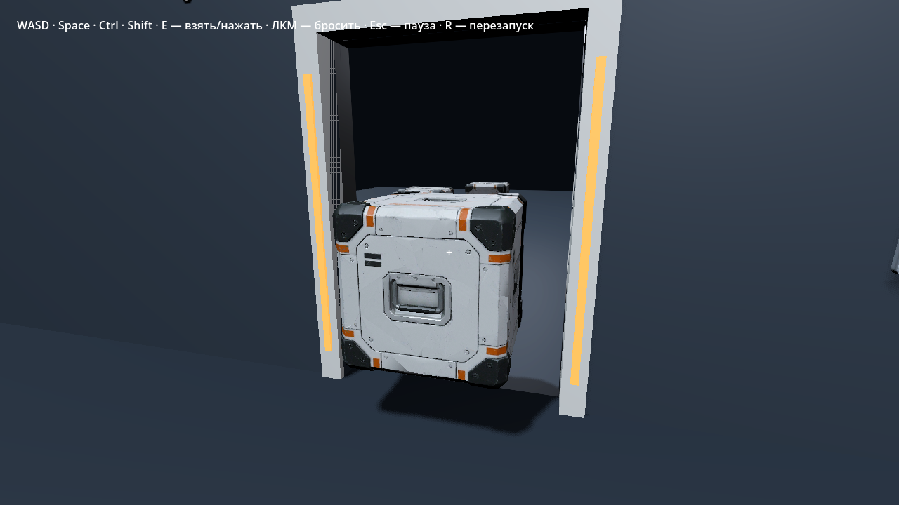
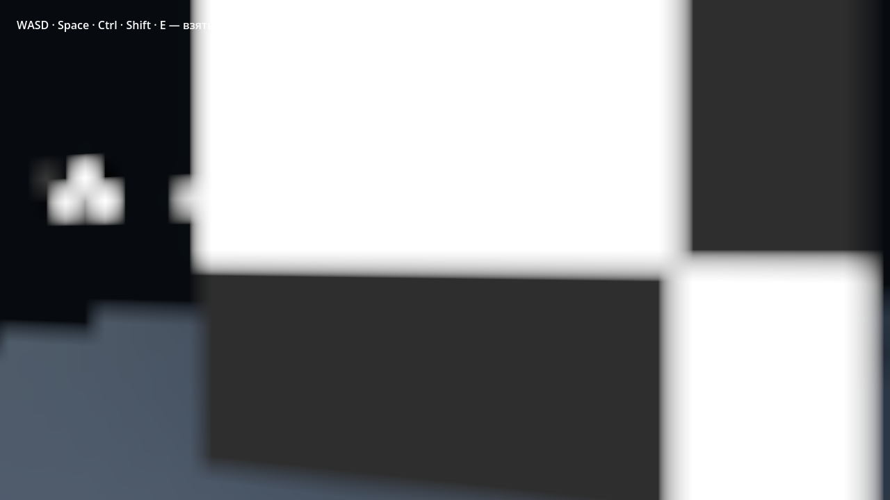
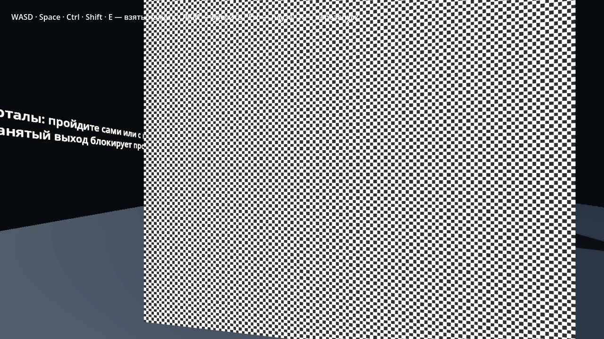

# SKL-09: прохождение и изображение порталов — 2026-11-10

Версия: 0.0.10-dev, ветка `feat/skl-09-portals` от `653e1a8` (слитый PR №40). Проверялись изменения этой ветки до публикации PR. Решение и ограничения — [ADR-0013](../adr/0013-portal-traversal-and-view.md); состояние приёмки — [status](../status.md).

## Среда

Linux x86_64, официальный Godot **4.7.2.stable.official.ed1daf0bf** из закреплённого архива, Jolt. Headless — CPU/физика; отдельный графический запуск — Xorg dummy, окно **1280 × 720**, Vulkan **1.4.305**, Forward+, **llvmpipe (LLVM 19.1.7, 256 bits)**, Mesa 25.0.7. Это программная реализация Vulkan, не RTX владельца. Карты/модели проекта не заменялись.

## Проверки

Команды используют этот официальный редактор как `godot`; запуск из корня checkout.

| Проверка | Результат |
| --- | --- |
| `godot --headless --path . --import` | Импорт завершён без ошибок/предупреждений |
| Каждый `.gd` в `src`, `tests`, `tools` через `--script <путь> --check-only` | 132 скрипта; типы и предупреждения, форматирование — пройдены |
| Зависимости слоёв | 90 production-скриптов; лексические правила `check_layers.ps1` воспроизведены отдельной локальной проверкой, нарушений нет |
| `godot --headless --path . --script tests/run_tests.gd -- --suite all` | 284/284, unit/contract/integration/regression, физика 60 Гц |
| Портальные `PortalTests` + `PortalTraversalTests`, `--fixed-fps 30` / `144` | 20/20 при каждой частоте отрисовки; физика 60 Гц |
| Отрицательные случаи runner | Намеренный failure — exit 1; неизвестная suite и отсутствие её имени — exit 2 |
| `godot --path . --script tools/portal_smoke.gd` | `PORTAL_SMOKE_PASSED`, реальный графический путь Vulkan/Forward+, кадры и ввод через SessionInput |
| `python tools/check_docs.py` | Локальные ссылки и 430 прежних якорей — пройдены |

Локально PowerShell runner не запускался: операции импорта, перечисления скриптов, проверки слоёв/формата, тестов и отрицательных exit code выполнены напрямую. Результат именно `tools/check.ps1`, упаковки экспортов и запуска Linux release проверяет CI PR отдельно; эта таблица его заранее не объявляет успешным.

### Поведение

- Игрок проходит A→B и возвращается; преобразуются центр капсулы, скорость, up и камера.
- E-удерживаемый куб проходит вместе с игроком, остаётся в рамке удержания; бросок после выхода сохраняет направление.
- Полностью вставленный до перехода игрока куб сохраняет удалённое представление. Его бросок переносит также отложенный импульс. Занятая удалённая поза и выключение питания дают безопасный сброс перед входом.
- Выход на пол и потолок поворачивает игрока/камеру с сохранением выходного импульса; следующий шаг движения выбирает эффективное поле выхода.
- Проверены 25 м/с для свободного куба, край/габарит, путь на выходе, защита от повтора, stale/duplicate tick, неверный scope, питание, reset и освобождение scope.
- Перегородка занятого выхода физически останавливает игрока и куб; убранное препятствие освобождает проход без перезапуска.
- Визуальная копия содержит только меши, не добавляет физических тел; исходный материал возвращается при выключении.

В Vulkan-smoke уровень открыт через кнопку меню. После получения фокуса окна физические события E/W/Shift/ЛКМ прошли через обычный SessionInput: захват → переход связки → бросок. Это автоматический сценарий, а не прохождение человеком.

## Изображение

Полукуб снят с обеих сторон и осмотрен: наружные половины соединяются в проёме, полого среза и видимых внутренних граней нет. Кадры: [вход](portals-2026-11-10/half-entry.png), [выход](portals-2026-11-10/half-exit.png), [после перехода с кубом](portals-2026-11-10/player-held.png).

Для близкого косого взгляда за выходом временно установлен контрастный checker. Глаз — 3 см перед входной плоскостью, yaw 0,18 рад. Поза камеры и цель одинаковы; сравнивается прежняя стратегия всего проёма 720 × 1080 с новой видимой областью 1280 × 720. Число контрастных переходов в центральных 30 % ширины, среднее трёх строк: **0 → 86**. Видимая область: начало `(0.143051, 0.425287)`, размер `(0.087870, 0.049427)` м. Это воспроизводимая проверка сохранения деталей, не универсальная метрика качества или FPS. Near-plane не срезал мембрану; фон вне конечной тестовой сетки ожидаем.

| Весь проём | Видимая область |
| --- | --- |
|  |  |

## Остаток приёмки

Нужны повтор обновлённого smoke и ручной осмотр на RTX 4070 Ti SUPER: близкий взгляд с небольшими поворотами, медленный/быстрый переход, удержание и бросок, блокировка/питание, комфорт и стоимость второго прохода по F3/F4. Прежний аппаратный результат SKL-08 эти изменения не подтверждает. Новый Windows release и ручное прохождение экспортированных сборок здесь не выполнялись.

Удалённая половина удерживаемого куба — визуальный меш, не отдельная физика; взаимодействие с удалёнными устройствами до подтверждения переноса не заявлено. Рекурсия, движущиеся порталы и произвольные прозрачные/скелетные материалы не реализованы.
