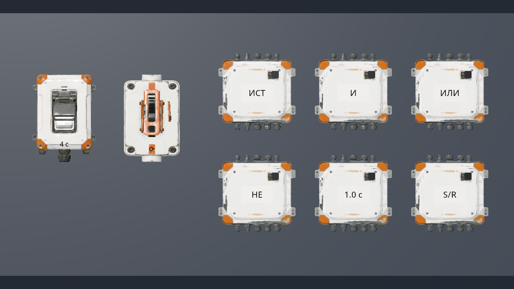
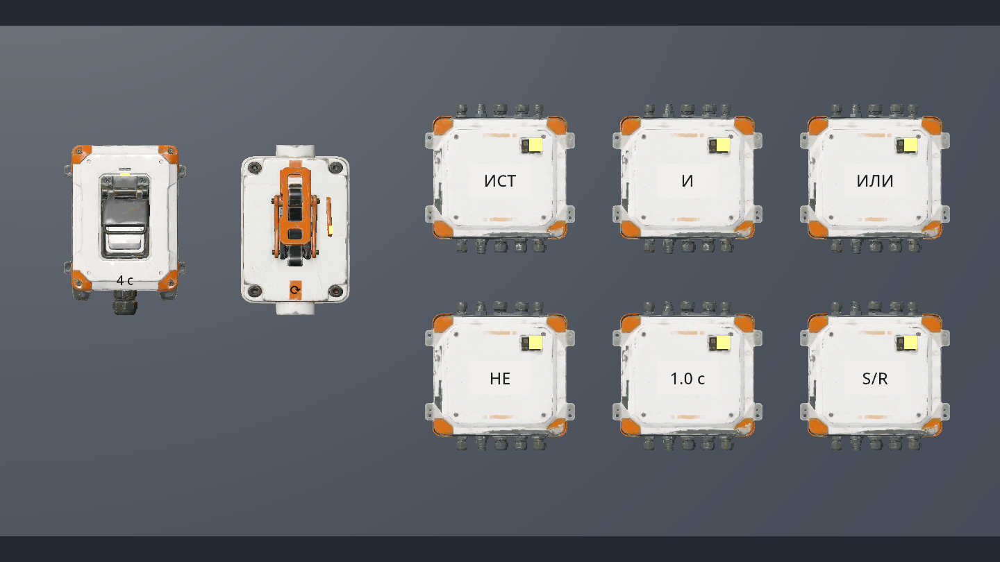
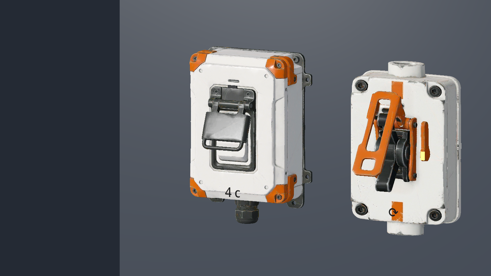
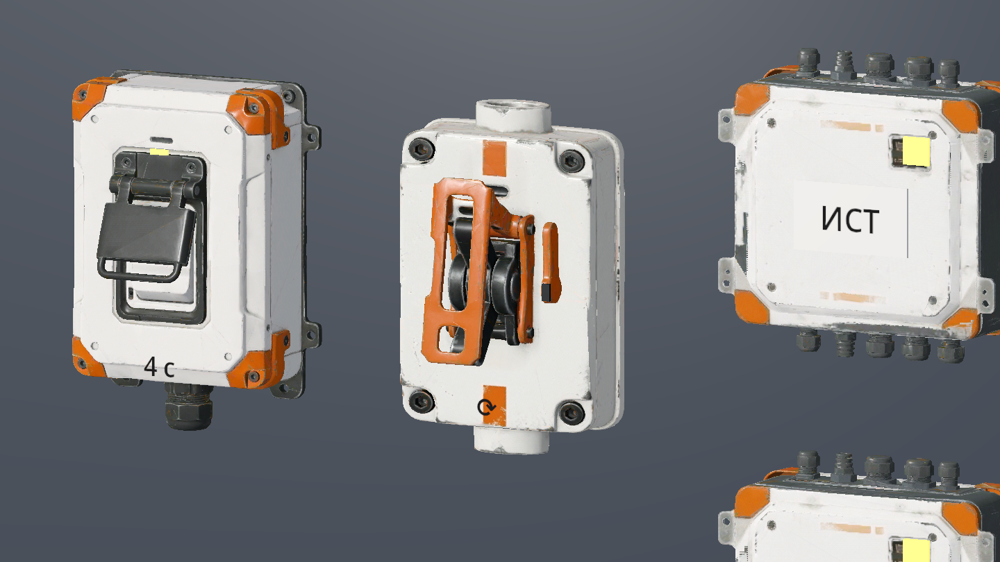
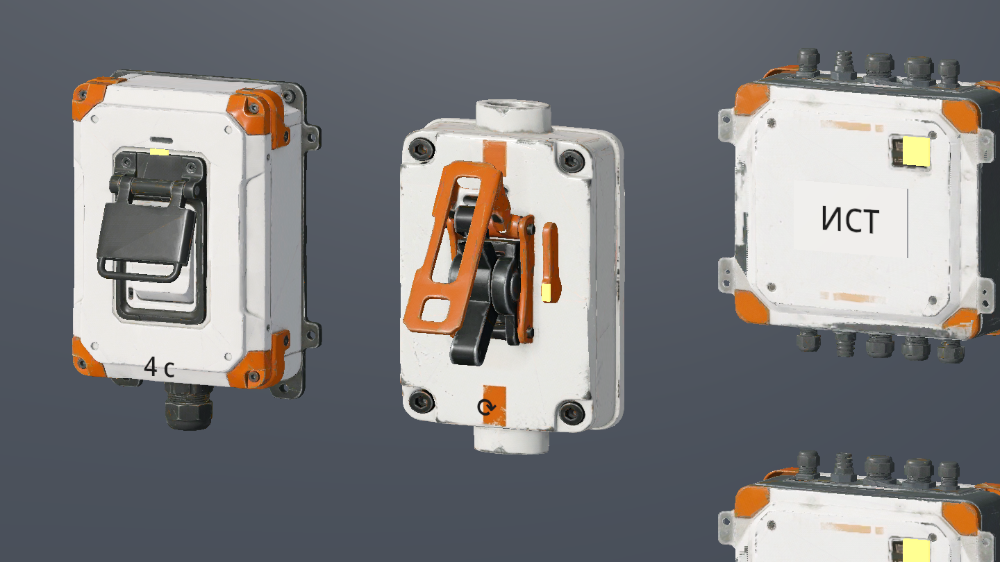

# Настенные устройства DEV-03/04/07 — 2026-11-11

Ветка `codex/meshy-wall-device`, база `844842f42e7533e5c196e7c93144b660717cc552`, рабочая версия 0.0.10-dev. Область: ART-04, визуальная замена трёх настенных устройств. Источники и SHA-256 игровых файлов — в [реестре](../../content/models/wall-devices-2026-11-11.json).

## Восстановление и реализация

В аккаунте владельца найдены три задачи Image to 3D со статусом `SUCCEEDED`, созданные 2026-11-11 около 06:36 UTC. Скачаны исходные GLB и превью. По виду установлено соответствие защищённой кнопке, рубильнику и логической панели. Каждая задача показывает `consumed_credits=35`; суммарно 105. При восстановлении выполнены только чтение API и скачивание: новых платных задач и дополнительных списаний нет.

Исходные PNG и POST-запросы из прежнего окружения недоступны. Поэтому идентификация выполнена по результатам; исходные промты, модель генератора и хеши референсов не восстановлены по догадке. API подтверждает `geometry_resolution=2k`; все фактические комплекты PBR — 2048 × 2048. Применена прежняя область MIT для моделей устройств; изображения каталога в репозиторий не включались.

- DEV-03: корпус и защитная крышка неподвижны, клавиша отдельно уходит по локальной −Z на 1,5 см и возвращается, в том числе при повороте всего прибора.
- DEV-04: наружная оранжевая рукоять поворачивается от корпуса вокруг горизонтального шарнира X; основание, боковые скобы и чёрные кулачки неподвижны. Повторное состояние не накапливает поворот, сброс возвращает исходную позу.
- DEV-07: общий корпус для SOURCE, AND, OR, NOT, DELAY, LATCH; шесть надписей перед геометрией крышки. Свечение ламп задаёт состояние игры.
- Модели не добавляют физических тел. У кнопки/рубильника остаётся бокс 0,36 × 0,5 × 0,16 м; у панели нет коллизии. Правила сети, время удержания, память, каналы и уровни не изменены.

## Проверки

Среда: Debian 13 x86_64, официальный Godot **4.7.2.stable.official.ed1daf0bf**, проверенный по SHA-512 из `tools/toolchain.json`; PowerShell 7.5.4. Vulkan **1.4.305**, Forward+, **llvmpipe (LLVM 19.1.7, 256 bits)** через Xvfb. Это программный Vulkan, а не проверка на видеокарте владельца. Для графического запуска выбран аудиодрайвер `Dummy`.

| Проверка | Фактический результат |
| --- | --- |
| `tools/check.ps1 -GodotPath <Godot 4.7.2>` | Слои: 93 скрипта; типы/синтаксис: 141 скрипт; **343/343** при обычной cadence, **343/343** при 30 и **343/343** при 144 кадрах/с. Отрицательные сценарии runner пройдены |
| Повторная нормализация из тех же GLB | Все **15 файлов** воспроизведены побайтово; SHA-256 записаны в реестре |
| Геометрия экспорта | 60 590 треугольников; вырожденных нет; координаты/UV конечны, нормали единичные. Относительное изменение площади поверхности после разрезов менее 10⁻⁶ |
| Импорт и `wall_devices_smoke.gd` на Vulkan | `WALL_DEVICES_SMOKE_PASSED`; обе позы, возврат, повторный сигнал, неподвижные корпуса, локальная ось нажатия, отсутствие добавленной физики, шесть типов и таблички перед крышкой |
| Документация | `python tools/check_docs.py`, локальные ссылки и якоря без ошибок |

После проверки двигались только сигнальные лампы/подписи и очищались вырожденные треугольники экспортёра. Для окончательных файлов отдельно повторены импорт, проверка типов затронутых скриптов, воспроизводимость нормализации и Vulkan-smoke; физические правила не менялись.

Команда проверки моделей из корня проекта, с работающим Vulkan-дисплеем и существующим каталогом назначения:

```bash
godot --path . --rendering-driver vulkan --audio-driver Dummy \
  --script tools/art/wall_devices_smoke.gd -- --capture /absolute/path/wall-devices.png
```












## Непроверенный остаток и ограничения

Оригинальные PNG не восстановлены, поэтому точное сравнение с ними не выполнено. Художественная приёмка владельцем, полное ручное прохождение, отдельный замер производительности, экспорт и запуск этой ревизии на Windows/RTX не выполнены.

Лицевая декоративная геометрия кнопки и рубильника выступает за прежнюю коллизию и не служит новой физической опорой. Подвижные детали выделены измеренными геометрическими срезами; закрывающие торцы не достроены, срезы скрыты соседними деталями. Защитная крышка и чёрные кулачки остаются декоративными. Мелкая псевдомаркировка в текстуре окна панели не используется как инструкция. Подписи — существующий технический `Label3D`, а не завершение диегетического UI.
